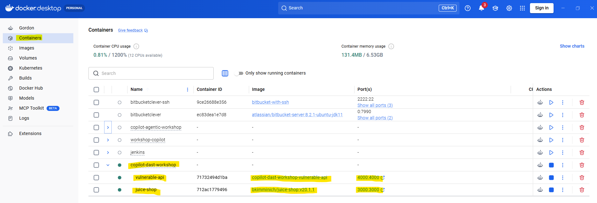
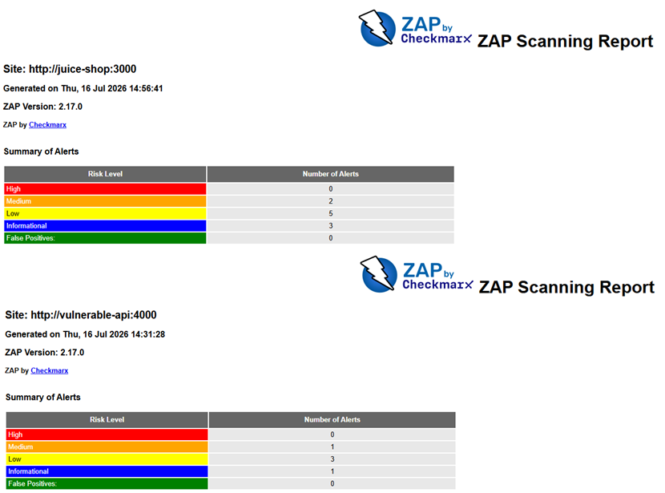
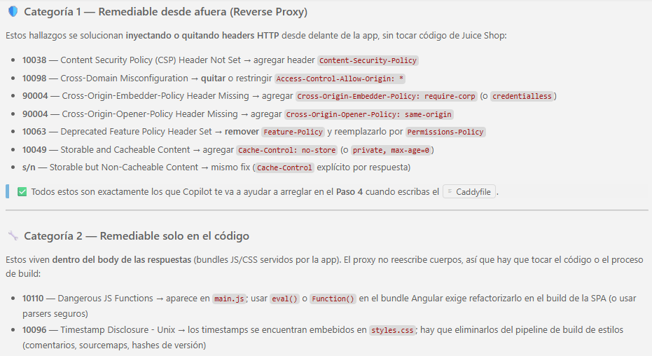
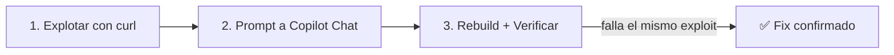
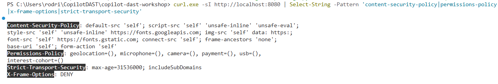
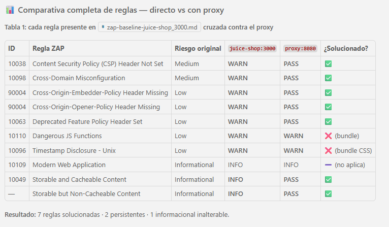
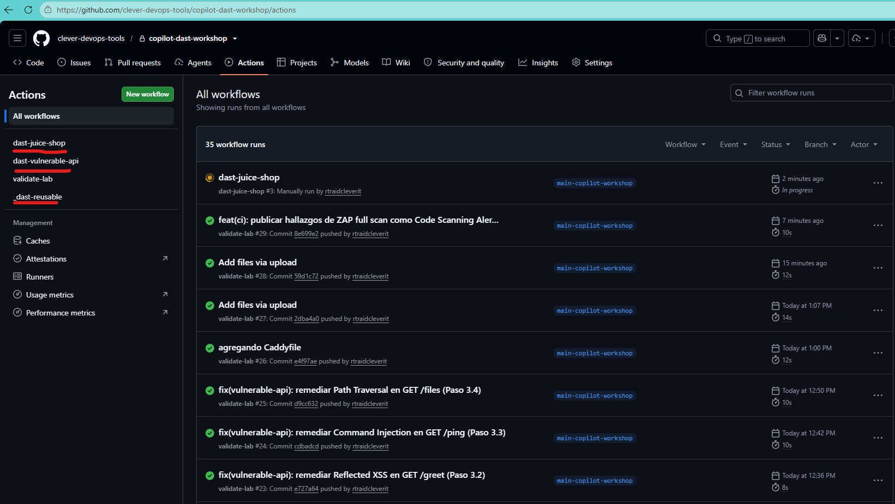

<div align="center">
  

  # Copilot para Vulnerabilidades de Seguridad DAST con ZAP Proxy

  [](https://github.com/features/copilot)
  [](https://www.zaproxy.org/)
  [](https://nodejs.org/)
  [](https://www.docker.com/)
</div>

---

**Esta capacitación práctica** te enseñará a **acelerar la remediación de vulnerabilidades de seguridad dinámica (DAST)** usando **GitHub Copilot Chat** sobre reportes generados con **OWASP ZAP Proxy**. Cubriremos los dos escenarios más comunes en la vida real: cuando **sí tenés el código fuente** (refactor asistido) y cuando **no lo tenés** (mitigación con reverse proxy).

> Para más información sobre las herramientas usadas en este taller, consulta la documentación oficial:
>
> - [GitHub Copilot Chat](https://docs.github.com/en/copilot/how-tos/use-copilot-chat)
> - [OWASP ZAP](https://www.zaproxy.org/docs/)
> - [ZAP Baseline Scan](https://www.zaproxy.org/docs/docker/baseline-scan/)
> - [ZAP Full Scan](https://www.zaproxy.org/docs/docker/full-scan/)
> - [OWASP Top 10](https://owasp.org/Top10/)
> - [DAST en el SDLC](https://owasp.org/www-project-devsecops-guideline/latest/02b-Dynamic-Application-Security-Testing)

---

## 📋 Tabla de Contenidos

1. [🚀 Ejecutar la aplicación](#-ejecutar-la-aplicación)
2. [🔍 Paso 1. Primer escaneo DAST con OWASP ZAP](#-paso-1-primer-escaneo-dast-con-owasp-zap)
3. [🧠 Paso 2. Analizar el reporte con GitHub Copilot Chat](#-paso-2-analizar-el-reporte-con-github-copilot-chat)
4. [🔧 Paso 3. Remediar vulnerabilidades en código con Copilot](#-paso-3-remediar-vulnerabilidades-en-código-con-copilot)
   - [3.1 SQL Injection](#31-sql-injection)
   - [3.2 Reflected XSS](#32-reflected-xss)
   - [3.3 Command Injection](#33-command-injection)
   - [3.4 Path Traversal](#34-path-traversal)
5. [🛡️ Paso 4. Remediar sin acceso al código (Reverse Proxy)](#️-paso-4-remediar-sin-acceso-al-código-reverse-proxy)
6. [🔁 Paso 5. Re-escanear y comparar antes/después](#-paso-5-re-escanear-y-comparar-antesdespués)
7. [🤖 Paso 6. Automatizar el DAST con GitHub Actions (Bonus)](#-paso-6-automatizar-el-dast-con-github-actions-bonus)

---

## ⏱️ Duración estimada

| Bloque                                                 | Tiempo      |
| ------------------------------------------------------ | ----------- |
| 🚀 Setup y ejecución de la aplicación                  | 10 min      |
| 🔍 Paso 1 - Primer escaneo DAST                        | 10 min      |
| 🧠 Paso 2 - Análisis del reporte con Copilot           | 10 min      |
| 🔧 Paso 3 - Remediación en código (4 vulnerabilidades) | 30 min      |
| 🛡️ Paso 4 - Remediación con reverse proxy              | 15 min      |
| 🔁 Paso 5 - Re-escaneo y comparación                   | 10 min      |
| 🤖 Paso 6 - Bonus GitHub Actions                        | 5 min       |
| **Total**                                              | **~90 min** |

---

## 🎯 Objetivos de aprendizaje

Al finalizar este workshop serás capaz de:

- ✅ Ejecutar un escaneo DAST **baseline** y **full** con **OWASP ZAP** contra dos targets: una API propia con código fuente disponible y una app de terceros (Juice Shop).
- ✅ Usar **GitHub Copilot Chat** para **interpretar hallazgos** de ZAP y priorizar remediaciones.
- ✅ Aplicar el **enfoque directo** (refactor de código) para eliminar SQLi, XSS, Command Injection y Path Traversal.
- ✅ Aplicar el **enfoque indirecto** (reverse proxy Caddy) cuando el código no es tuyo.
- ✅ Verificar el impacto de las remediaciones con un **segundo escaneo** y comparar métricas antes/después.
- ✅ Automatizar el flujo DAST en un **pipeline de GitHub Actions**.

---

## 📚 Requisitos previos

Antes de comenzar, asegúrate de tener:

- [Docker Desktop](https://www.docker.com/products/docker-desktop/) instalado y en ejecución (con Docker Compose v2).
- [Git](https://git-scm.com/downloads).
- [Visual Studio Code](https://code.visualstudio.com/).
- [GitHub Copilot](https://github.com/features/copilot) activo en VS Code (extensión + suscripción).
- Terminal con `curl` disponible (nativo en macOS/Linux; en Windows viene con Git Bash o PowerShell 7+).

Verifica tu instalación:

```bash
docker --version
docker compose version
git --version
code --version
```

---

## 🚀 Ejecutar la aplicación

Para levantar el laboratorio tienes dos opciones:

1. **Ejecución Manual:** Consulta la página [about.md](./about.md), donde encontrarás los pasos detallados y una descripción de los servicios que se levantan.
2. **Asistencia de Copilot Agent:** Puedes pedirle al agente que se encargue de la ejecución. Abre el chat en tu editor en modo agente y usa un prompt como el siguiente:

    > "Analiza la estructura del proyecto y ejecuta los comandos necesarios para levantar el laboratorio DAST usando Docker Compose."

Este workshop levanta **dos aplicaciones vulnerables** y **un escáner DAST** vía Docker Compose:

- **`vulnerable-api`** — API Node.js/Express con 4 vulnerabilidades del OWASP Top 10 (código fuente propio).
- **`juice-shop`** — OWASP Juice Shop, aplicación de terceros usada para el escenario "sin código fuente".
- **`zap`** — OWASP ZAP como escáner DAST (bajo demanda con el perfil `scan`).
- **`proxy`** — Reverse proxy Caddy con security headers (bajo demanda con el perfil `hardened`).

### Comandos rápidos

```bash
# Levantar el laboratorio
docker compose up -d

# Verificar que todo está corriendo
docker compose ps
```

> [!IMPORTANT]
> **¿Repetís el workshop?** `docker compose up -d` reutiliza la imagen local `copilot-dast-workshop-vulnerable-api` si ya existe. Como el `Dockerfile` hace `COPY src ./src`, esa imagen conserva el código **tal cual estaba cuando la construiste** — si en una corrida previa ya aplicaste los fixes del Paso 3, los exploits del Paso 3.1 devolverán `{"results":[]}` en lugar de exponer la vulnerabilidad. Para arrancar desde el estado vulnerable original, forzá un rebuild:
>
> ```bash
> docker compose up -d --build vulnerable-api
> ```
>
> O partí de cero con `./scripts/cleanup.sh` / `./scripts/cleanup.ps1` (elimina contenedores, redes y volúmenes) y volvé a levantar con `docker compose up -d --build`.

Alternativamente puedes usar los scripts incluidos:

| Plataforma       | Levantar              | Detener              | Limpiar                 |
| ---------------- | --------------------- | -------------------- | ----------------------- |
| macOS / Linux    | `./scripts/start.sh`  | `./scripts/stop.sh`  | `./scripts/cleanup.sh`  |
| Windows (pwsh)   | `./scripts/start.ps1` | `./scripts/stop.ps1` | `./scripts/cleanup.ps1` |

### URLs del laboratorio

| Servicio           | URL                       | Notas                                        |
| ------------------ | ------------------------- | -------------------------------------------- |
| `vulnerable-api`   | <http://localhost:4000>   | Endpoints vulnerables (Escenario código propio). |
| `juice-shop`       | <http://localhost:3000>   | App de terceros (Escenario sin código).      |
| `proxy` endurecido | <http://localhost:8080>   | Solo tras `--profile hardened` en Paso 4.    |



---

## 🔍 Paso 1. Primer escaneo DAST con OWASP ZAP

**Objetivo:** ejecutar un escaneo **baseline** con OWASP ZAP contra las dos aplicaciones y obtener el reporte inicial que usaremos como línea base.

> [!NOTE]
> El `baseline` de ZAP es un escaneo **pasivo** (rápido, ~2 min) que solo analiza las respuestas HTTP que encuentra al crawlear. El `full-scan` es **activo**: envía payloads reales de SQLi, XSS, etc. Empezamos con baseline para tener resultados rápidos.

> [!IMPORTANT]
> **Convención de shells en este workshop:** los bloques etiquetados `bash` usan `\` para continuar línea (macOS / Linux / Git Bash). Los bloques etiquetados `powershell` usan backtick `` ` `` (Windows PowerShell / pwsh). Copiá el bloque que corresponde a tu terminal.

### 1.1 Escanear `vulnerable-api` (código propio)

```bash
# macOS / Linux
./scripts/scan.sh baseline http://vulnerable-api:4000
```

```powershell
# Windows (PowerShell)
./scripts/scan.ps1 baseline http://vulnerable-api:4000
```

También podés invocar Docker Compose directamente. Elegí el bloque según tu shell:

```bash
# Bash / zsh (macOS / Linux): continuación de línea con `\`
docker compose --profile scan run --rm zap \
  zap-baseline.py -t http://vulnerable-api:4000 \
  -c /zap/config/rules.tsv \
  -r zap-baseline-vulnerable-api_4000.html \
  -J zap-baseline-vulnerable-api_4000.json \
  -w zap-baseline-vulnerable-api_4000.md -I
```

```powershell
# PowerShell (Windows): continuación de línea con backtick `` ` ``
docker compose --profile scan run --rm zap `
  zap-baseline.py -t http://vulnerable-api:4000 `
  -c /zap/config/rules.tsv `
  -r zap-baseline-vulnerable-api_4000.html `
  -J zap-baseline-vulnerable-api_4000.json `
  -w zap-baseline-vulnerable-api_4000.md -I
```

### 1.2 Escanear `juice-shop` (código de terceros)

```bash
# macOS / Linux
./scripts/scan.sh baseline http://juice-shop:3000
```

```powershell
# Windows (PowerShell)
./scripts/scan.ps1 baseline http://juice-shop:3000
```

### 1.3 Revisar los reportes

> [!NOTE]
> Los reportes solo existen **después de ejecutar los escaneos** de 1.1 (`vulnerable-api`) y/o 1.2 (`juice-shop`). El nombre incluye el slug del target (ej. `zap-baseline-vulnerable-api_4000.html`, `zap-baseline-juice-shop_3000.html`). Si el archivo que intentás abrir "no existe", volvé al paso anterior y corré el escaneo correspondiente primero.

Los reportes se generan en la carpeta [`reports/`](./reports/) en tres formatos:

| Archivo                                                | Uso sugerido                              |
| ------------------------------------------------------ | ----------------------------------------- |
| `zap-baseline-<target>.html`                           | Abrirlo en el navegador para revisión.    |
| `zap-baseline-<target>.json`                           | Ingesta programática (dashboards).        |
| `zap-baseline-<target>.md`                             | Compartir en PRs y usar con Copilot Chat. |

Listar los reportes disponibles en tu carpeta:

```bash
# macOS / Linux
ls -1 reports/zap-*.html reports/zap-*.json reports/zap-*.md 2>/dev/null
```

```powershell
# Windows (PowerShell)
Get-ChildItem reports\zap-*.html, reports\zap-*.json, reports\zap-*.md | Select-Object Name
```

Abrir el HTML de `juice-shop` (reemplazá el nombre por el que quieras revisar):

```bash
# macOS / Linux
open reports/zap-baseline-juice-shop_3000.html
```

```powershell
# Windows (PowerShell)
Invoke-Item reports/zap-baseline-juice-shop_3000.html
```

Abrir el HTML de `vulnerable-api`:

```bash
# macOS / Linux
open reports/zap-baseline-vulnerable-api_4000.html
```

```powershell
# Windows (PowerShell)
Invoke-Item reports/zap-baseline-vulnerable-api_4000.html
```



---

## 🧠 Paso 2. Analizar el reporte con GitHub Copilot Chat

**Objetivo:** en lugar de leer manualmente cientos de líneas del reporte, dejamos que **GitHub Copilot Chat** interprete los hallazgos y nos priorice qué remediar primero.

### 2.1 Abrir el reporte en VS Code

Abrí el archivo Markdown del reporte en tu editor. Por ejemplo:

```bash
code reports/zap-baseline-juice-shop_3000.md
```

Este es el formato que mejor entiende Copilot Chat porque el contexto es texto plano estructurado.

### 2.2 Usar Copilot Chat para interpretar los hallazgos

Con el reporte abierto, abrí el chat de Copilot (`Ctrl+Alt+I` / `Cmd+Ctrl+I`) y usá este prompt:

```text
Analiza este reporte de OWASP ZAP (#file:zap-baseline-juice-shop_3000.md) y genera una tabla en Markdown con las 5 vulnerabilidades más importantes. Para cada una incluye:

- ID de regla
- Título de la alerta
- Severidad (High/Medium/Low)
- Un resumen en una línea
- Qué header HTTP, config o cambio de código las remediaría
```

**Resultado esperado (aproximado, puede variar):**

| ID    | Título                             | Severidad | Fix sugerido                              |
| ----- | ---------------------------------- | --------- | ----------------------------------------- |
| 10038 | Content Security Policy no seteado | Medium    | Header `Content-Security-Policy`          |
| 10063 | Deprecated Feature-Policy          | Info      | Reemplazar por `Permissions-Policy`       |
| 10098 | Cross-Domain Misconfiguration      | Medium    | Remover `Access-Control-Allow-Origin: *`  |
| 90004 | COEP faltante                      | Medium    | Header `Cross-Origin-Embedder-Policy`     |
| 10049 | Storable and Cacheable Content     | Info      | `Cache-Control: no-store`                 |

### 2.3 Prompt de seguimiento: agrupar por tipo de fix

Copilot ya te dio un panorama. Ahora pedile un plan de ataque:

```text
Ahora agrupa los hallazgos de #file:zap-baseline-juice-shop_3000.md en dos categorías:

1. Remediable desde afuera (headers HTTP faltantes, cache policy, CORS mal configurado): pueden mitigarse con un reverse proxy que inyecte headers.
2. Remediable solo en el código: bugs de la app que un proxy no puede arreglar (ej. inline JS peligroso, endpoints con lógica insegura).

Genera dos listas Markdown con los IDs correspondientes.
```

> [!TIP]
> Este es el momento didáctico clave: **Copilot no adivina la política de seguridad de tu equipo**. Vos le decís qué headers querés, qué tipo de fix preferís, y Copilot escribe el código. La calidad del prompt determina la calidad del fix.



---

## 🔧 Paso 3. Remediar vulnerabilidades en código con Copilot

**Objetivo:** para cada una de las 4 vulnerabilidades canónicas de `vulnerable-api`, seguimos siempre el mismo ciclo de 3 pasos:



Los 4 endpoints vulnerables:

| # | Endpoint            | Vulnerabilidad    | OWASP Top 10 | Archivo                                                          |
| - | ------------------- | ----------------- | ------------ | ---------------------------------------------------------------- |
| 1 | `GET /users/search` | SQL Injection     | A03:2021     | [`src/routes/users.js`](./app-vulnerable-api/src/routes/users.js) |
| 2 | `GET /greet`        | Reflected XSS     | A03:2021     | [`src/routes/greet.js`](./app-vulnerable-api/src/routes/greet.js) |
| 3 | `GET /ping`         | Command Injection | A03:2021     | [`src/routes/ping.js`](./app-vulnerable-api/src/routes/ping.js)   |
| 4 | `GET /files`        | Path Traversal    | A01:2021     | [`src/routes/files.js`](./app-vulnerable-api/src/routes/files.js) |

Asegurate que la app esté levantada **con el código vulnerable actual del disco**. Usá `--build` para forzar que Docker reconstruya la imagen y no reutilice una imagen cacheada de una corrida anterior (que podría contener fixes ya aplicados):

```bash
docker compose up -d --build vulnerable-api
```

> [!TIP]
> Si los `curl` de explotación devuelven `{"results":[]}` u otro output "limpio" desde el primer intento, casi seguro estás pegándole a una imagen con los fixes ya compilados. Corré el `--build` de arriba y volvé a probar.

---

### 3.1 SQL Injection

**Endpoint vulnerable:** `GET /users/search`  · **Archivo:** [`app-vulnerable-api/src/routes/users.js`](./app-vulnerable-api/src/routes/users.js)

#### 1️⃣ Explotar la vulnerabilidad

```bash
curl -sG "http://localhost:4000/users/search" --data-urlencode "name=' OR '1'='1"
```

> [!TIP]
> En **Windows PowerShell 5.1** el nombre `curl` es alias de `Invoke-WebRequest`. Si al copiar el comando ves un error sobre `--data-urlencode` no reconocido, usá `curl.exe` en lugar de `curl` para invocar el binario real (Windows 10+ lo trae incluido).

Devuelve **todos** los usuarios (incluido `admin`) porque la condición `OR '1'='1'` bypassea el filtro.

#### 2️⃣ Prompt para Copilot Chat

Abrí [`app-vulnerable-api/src/routes/users.js`](./app-vulnerable-api/src/routes/users.js) en VS Code y pegá el siguiente prompt en Copilot Chat:

```text
El archivo #file:app-vulnerable-api/src/routes/users.js es vulnerable a SQL Injection porque concatena el parámetro `name` directamente en la query. Refactorízalo para:

1. Usar prepared statements con parámetros ligados (better-sqlite3 soporta `?`).
2. Mantener la búsqueda por substring (`LIKE %...%`).
3. NO devolver la query cruda al cliente en la respuesta.
4. Retornar 400 si `name` es más largo de 100 caracteres.
```

**Aceptá el cambio propuesto por Copilot** y guardá el archivo.

#### 3️⃣ Verificar el fix

```bash
docker compose up -d --build vulnerable-api
curl -sG "http://localhost:4000/users/search" --data-urlencode "name=' OR '1'='1"
# → {"results":[]}   (el string se busca literal, sin bypass)

curl -sG "http://localhost:4000/users/search" --data-urlencode "name=alice"
# → {"results":[{"id":1,"name":"alice","email":"alice@example.com"}]}
```

---

### 3.2 Reflected XSS

**Endpoint vulnerable:** `GET /greet`  · **Archivo:** [`app-vulnerable-api/src/routes/greet.js`](./app-vulnerable-api/src/routes/greet.js)

#### 1️⃣ Explotar la vulnerabilidad

```bash
curl -sG "http://localhost:4000/greet" --data-urlencode "name=<script>alert(1)</script>"
```

El `<script>` se refleja tal cual dentro del HTML devuelto y se ejecuta en el navegador de la víctima.

#### 2️⃣ Prompt para Copilot Chat

Abrí [`app-vulnerable-api/src/routes/greet.js`](./app-vulnerable-api/src/routes/greet.js) y usá este prompt:

```text
El archivo #file:app-vulnerable-api/src/routes/greet.js sufre Reflected XSS porque interpola `name` en HTML sin escapar. Refactorízalo para:

1. Escapar entidades HTML (<, >, ", ', &) antes de renderizar el nombre.
2. NO usar librerías externas — implementá una función `escapeHtml` pequeña dentro del archivo.
3. Limitar `name` a 50 caracteres, devolviendo 400 si excede.
```

#### 3️⃣ Verificar el fix

```bash
# Bash / zsh
docker compose up -d --build vulnerable-api
curl -sG "http://localhost:4000/greet" --data-urlencode "name=<script>alert(1)</script>" | grep -c '<script>'
# → 0   (el <script> quedó codificado como &lt;script&gt;)
```

```powershell
# PowerShell: Select-String reemplaza grep; curl.exe evita el alias hacia Invoke-WebRequest
docker compose up -d --build vulnerable-api
(curl.exe -sG "http://localhost:4000/greet" --data-urlencode "name=<script>alert(1)</script>" | Select-String '<script>').Count
# → 0   (el <script> quedó codificado como &lt;script&gt;)
```

---

### 3.3 Command Injection

**Endpoint vulnerable:** `GET /ping`  · **Archivo:** [`app-vulnerable-api/src/routes/ping.js`](./app-vulnerable-api/src/routes/ping.js)

#### 1️⃣ Explotar la vulnerabilidad

```bash
curl -sG "http://localhost:4000/ping" --data-urlencode "host=127.0.0.1;id"
```

Al terminar el ping, el `;id` se ejecuta como comando extra y devuelve `uid=1000(node) gid=1000(node)...`.

#### 2️⃣ Prompt para Copilot Chat

Abrí [`app-vulnerable-api/src/routes/ping.js`](./app-vulnerable-api/src/routes/ping.js) y usá este prompt:

```text
El archivo #file:app-vulnerable-api/src/routes/ping.js es vulnerable a Command Injection porque interpola `host` en un string que se ejecuta con shell. Refactorízalo para:

1. Reemplazar `child_process.exec` por `child_process.execFile` (sin shell).
2. Validar que `host` cumpla un regex conservador: solo letras, dígitos, puntos y guiones; máximo 253 caracteres.
3. Rechazar con 400 "invalid host" si el regex no matchea.
4. Mantener el timeout de 3 segundos.
5. No devolver `stderr` completo al cliente para no filtrar detalles del sistema.
```

#### 3️⃣ Verificar el fix

```bash
docker compose up -d --build vulnerable-api

# Intento de exploit → rechazado
curl -sG "http://localhost:4000/ping" --data-urlencode "host=127.0.0.1;id"
# → invalid host

# Uso legítimo → sigue funcionando
curl -sG "http://localhost:4000/ping" --data-urlencode "host=127.0.0.1"
# → PING 127.0.0.1 ...
```

---

### 3.4 Path Traversal

**Endpoint vulnerable:** `GET /files`  · **Archivo:** [`app-vulnerable-api/src/routes/files.js`](./app-vulnerable-api/src/routes/files.js)

#### 1️⃣ Explotar la vulnerabilidad

```bash
curl -sG "http://localhost:4000/files" --data-urlencode "name=../../../../etc/passwd"
```

Devuelve el contenido real de `/etc/passwd` del contenedor porque `path.join` **normaliza pero no restringe** los `..`.

#### 2️⃣ Prompt para Copilot Chat

Abrí [`app-vulnerable-api/src/routes/files.js`](./app-vulnerable-api/src/routes/files.js) y usá este prompt:

```text
El archivo #file:app-vulnerable-api/src/routes/files.js es vulnerable a Path Traversal. Refactorízalo para:

1. Rechazar con 400 "invalid name" si `name` contiene separadores de ruta (`/`, `\`) o cadenas `..`.
2. Resolver la ruta final con `path.resolve(BASE_DIR, name)`.
3. Verificar que la ruta resuelta empiece con `BASE_DIR + path.sep`; si no, rechazar con 400.
4. Devolver 404 "not found" cuando el archivo no exista, sin filtrar detalles del filesystem.
```

#### 3️⃣ Verificar el fix

```bash
docker compose up -d --build vulnerable-api

# Intento de escape → rechazado
curl -sG "http://localhost:4000/files" --data-urlencode "name=../../../../etc/passwd"
# → invalid name

# Uso legítimo → sigue funcionando
curl -sG "http://localhost:4000/files" --data-urlencode "name=hello.txt"
# → Hello from vulnerable-api!
```

> [!TIP]
> **Prompt bonus:** cuando termines de arreglar las 4 rutas, pedile a Copilot que revise todas juntas con un prompt como:
>
> ```text
> Revisá los cuatro archivos #file:src/routes/users.js #file:src/routes/greet.js #file:src/routes/ping.js #file:src/routes/files.js y sugerí un middleware Express común que aplique rate-limiting básico y logging de intentos fallidos, para dificultar la enumeración de vulnerabilidades.
> ```

---

## 🛡️ Paso 4. Remediar sin acceso al código (Reverse Proxy)

**Objetivo:** cuando el código vulnerable **NO es tuyo** (SaaS, imagen de terceros, monolito legacy), Copilot te ayuda a construir un **reverse proxy Caddy** que inyecta los headers de seguridad faltantes **por delante** de la aplicación.

Este es exactamente el patrón que usarías en producción con un **WAF** o un **Ingress endurecido** en Kubernetes.

### 4.1 Interpretar los findings de headers

Los hallazgos WARN típicos del baseline scan de Juice Shop son todos de **headers HTTP faltantes** (CSP, COEP, Permissions-Policy, etc.). Idealmente ya los identificaste en el Paso 2.

### 4.2 Generar el `Caddyfile` con Copilot

Abrí Copilot Chat con contexto en el reporte y usá este prompt:

```text
Basándote en los findings de #file:zap-baseline-juice-shop_3000.md, generá un `Caddyfile` para Caddy 2 que actúe como reverse proxy delante de `http://juice-shop:3000`, escuche en el puerto 8080 y añada los siguientes headers de seguridad de respuesta:

- Content-Security-Policy (compatible con una SPA Angular que usa inline styles y JIT)
- Cross-Origin-Embedder-Policy: credentialless
- Cross-Origin-Opener-Policy: same-origin
- Cross-Origin-Resource-Policy: same-origin
- Permissions-Policy con geolocation, microphone, camera, payment, usb, interest-cohort deshabilitados
- Referrer-Policy: strict-origin-when-cross-origin
- X-Content-Type-Options: nosniff
- X-Frame-Options: DENY
- Strict-Transport-Security: max-age=31536000; includeSubDomains
- Cache-Control: no-store

También eliminá los headers `Server`, `X-Powered-By`, `Feature-Policy` y `Access-Control-Allow-Origin` que vienen del upstream. Desactivá HTTPS automático y la API admin de Caddy.
```

Guardá la respuesta en [`proxy/Caddyfile`](./proxy/Caddyfile). Si te trabaste, podés comparar con el archivo de referencia ya incluido en el repo.

### 4.3 Agregar el servicio `proxy` al Docker Compose

> [!NOTE]
> Este servicio ya está definido en el [`docker-compose.yml`](./docker-compose.yml) del repo bajo el perfil `hardened`. Si el archivo lo tuvieras vacío, este prompt le dice a Copilot cómo agregarlo:

```text
Agregá un servicio llamado `proxy` a #file:docker-compose.yml usando la imagen `caddy:2.11.4-alpine`. Requisitos:

- Debe estar bajo el perfil `hardened` (no arranca con `docker compose up` por defecto).
- Depende de `juice-shop` con `condition: service_healthy`.
- Monta `./proxy/Caddyfile` como `/etc/caddy/Caddyfile` en modo solo lectura.
- Expone el puerto 8080:8080.
- Se conecta a la red `dast-lab`.
- `container_name: proxy`.
```

### 4.4 Levantar el proxy endurecido

```bash
docker compose --profile hardened up -d proxy
```

Verificá que responde con los nuevos headers:

```bash
# Bash / zsh
curl -sI http://localhost:8080 | grep -Ei 'content-security-policy|permissions-policy|x-frame-options|strict-transport-security'
```

```powershell
# PowerShell: Select-String reemplaza grep; curl.exe evita el alias hacia Invoke-WebRequest
curl.exe -sI http://localhost:8080 | Select-String -Pattern 'content-security-policy|permissions-policy|x-frame-options|strict-transport-security'
```



---

## 🔁 Paso 5. Re-escanear y comparar antes/después

**Objetivo:** verificar con métricas concretas que el trabajo con Copilot **realmente redujo la superficie de ataque**.

### 5.1 Re-escanear el proxy endurecido (Escenario código de terceros)

```bash
# macOS / Linux
./scripts/scan.sh baseline http://proxy:8080
```

```powershell
# Windows (PowerShell)
./scripts/scan.ps1 baseline http://proxy:8080
```

Compará los dos archivos:

| Reporte                                       | Target                    |
| --------------------------------------------- | ------------------------- |
| `reports/zap-baseline-juice-shop_3000.md`     | Juice Shop directo        |
| `reports/zap-baseline-proxy_8080.md`          | Juice Shop tras el proxy  |

**Resultado típico medido en el laboratorio:**

| Métrica    | Directo (`juice-shop:3000`) | Con proxy (`proxy:8080`) | Δ    |
| ---------- | --------------------------- | ------------------------ | ---- |
| `PASS`     | 59                          | 62                       | +3   |
| `WARN-NEW` | 7                           | 4                        | −3   |
| `FAIL-NEW` | 0                           | 0                        | =    |

### 5.2 Re-escanear el código remediado (Escenario código propio) con **full-scan**

> [!IMPORTANT]
> El baseline scan es **pasivo** y no detecta SQLi, XSS ni Command Injection porque no envía payloads. Para validar el Paso 3 necesitás un **full-scan activo**. Tarda 2–5 min contra `vulnerable-api`.

```bash
# macOS / Linux
./scripts/scan.sh full http://vulnerable-api:4000
```

```powershell
# Windows (PowerShell)
./scripts/scan.ps1 full http://vulnerable-api:4000
```

Compará los `FAIL-NEW` antes y después. Deberías ver una **reducción a cero** de las alertas de SQLi, XSS, cmd-injection y path-traversal.

### 5.3 Prompt bonus: pedir a Copilot un resumen de mejoras

Con los dos reportes en tu workspace:

```text
Comparando #file:reports/zap-baseline-juice-shop_3000.md y #file:reports/zap-baseline-proxy_8080.md, generá una tabla Markdown con:

- Cada regla ZAP presente en el primer reporte
- Su estado (WARN / PASS / FAIL) en cada reporte
- Un check ✅ / ❌ indicando si el reverse proxy la solucionó

Al final, dame un párrafo ejecutivo explicando el impacto en términos de negocio.
```



---

## 🤖 Paso 6. Automatizar el DAST con GitHub Actions (Bonus)

**Objetivo:** llevar todo lo aprendido al pipeline para que **cada PR** dispare un escaneo DAST automatizado, sin que ningún developer tenga que acordarse.

### 6.1 Revisar los workflows incluidos

El repo ya trae **tres workflows** listos:

| Workflow                                                                                | Rol                                                    |
| --------------------------------------------------------------------------------------- | ------------------------------------------------------ |
| [`.github/workflows/_dast-reusable.yml`](.github/workflows/_dast-reusable.yml)          | Lógica compartida (`workflow_call`) — no corre sola.   |
| [`.github/workflows/dast-vulnerable-api.yml`](.github/workflows/dast-vulnerable-api.yml) | Escanea la `vulnerable-api` en CI (baseline / full).   |
| [`.github/workflows/dast-juice-shop.yml`](.github/workflows/dast-juice-shop.yml)        | Escanea `juice-shop` en CI (baseline / full).          |

### 6.2 Triggers configurados

Ambos wrappers usan el mismo esquema:

| Evento                        | Acción                                                     |
| ----------------------------- | ---------------------------------------------------------- |
| `workflow_dispatch`           | Ejecución manual (elegir `scan_type`: baseline o full).    |
| `pull_request` sobre `main`   | Cambios en `docker-compose.yml`, `zap/**` o el propio wrapper. |
| `schedule` (lunes 06:00 UTC)  | Escaneo semanal automatizado.                              |

### 6.3 Ejecutar manualmente desde GitHub

1. Push de tu rama a GitHub.
2. En la pestaña **Actions** del repositorio, seleccioná **dast-vulnerable-api** o **dast-juice-shop**.
3. Click en **Run workflow** → elegí `baseline` o `full`.
4. Al finalizar, descargá los reportes desde la sección **Artifacts** (`zap-<scan_type>-<target>`).

### 6.4 Prompt para extender el pipeline con Copilot

```text
Agregá al workflow #file:.github/workflows/_dast-reusable.yml un paso adicional que, cuando el scan_type sea "full", convierta el JSON de ZAP a formato SARIF y lo suba con `github/codeql-action/upload-sarif@v3` para que los hallazgos aparezcan como Code Scanning Alerts en la pestaña Security del repositorio.
```



---

## 🧹 Limpieza

Detener manteniendo los contenedores:

```bash
docker compose stop
```

Eliminar todo lo creado (contenedores, redes, volúmenes):

```bash
docker compose down -v
```

También podés usar los scripts:

- `./scripts/stop.sh` / `./scripts/stop.ps1`
- `./scripts/cleanup.sh` / `./scripts/cleanup.ps1`

---

## 📁 Estructura del repositorio

```text
copilot-dast-workshop/
├── README.md              # 👈 Este workshop (guía principal)
├── about.md               # Detalle de los servicios y ejecución manual
├── LICENSE                # Licencia MIT
├── .gitignore
├── docker-compose.yml     # juice-shop + vulnerable-api + proxy + zap
├── app-vulnerable-api/    # 4 endpoints con vulnerabilidades del OWASP Top 10
├── proxy/                 # Caddyfile con security headers (Paso 4)
├── zap/                   # Reglas de ZAP (rules.tsv)
├── scripts/               # scan / start / stop / cleanup (sh + ps1)
├── reports/               # Reportes ZAP generados (gitignored)
├── assets/                # Imágenes referenciadas en el README
└── .github/workflows/     # validate + dast-juice-shop + dast-vulnerable-api
                           #   + _dast-reusable
```

---

## 🧠 Puntos didácticos clave

1. **Copilot no reemplaza tu criterio de seguridad** — vos definís qué política aplicar; Copilot escribe el código de esa política.
2. **La calidad del prompt determina la calidad del fix** — sé específico con constraints (regex, timeouts, códigos HTTP, límites de tamaño).
3. **Un fix rara vez es un `replace`** — para Command Injection y Path Traversal, Copilot suele añadir validación de entrada, cambiar la API nativa (`execFile` en vez de `exec`), y mejorar los códigos de respuesta HTTP.
4. **Siempre verificar con el mismo exploit** que usaste para descubrir la vulnerabilidad — el feedback loop más rápido del workshop.
5. **La regla general:** si tenés el código, arreglá la raíz; si no lo tenés, mitigá con proxy/WAF; ambas estrategias son válidas y Copilot te acompaña en las dos.

---

<div align="center">

**¡Has llegado al final del workshop! 💫**

Si querés continuar profundizando, revisá el archivo [about.md](./about.md) para detalles adicionales sobre los servicios, o pedile a Copilot que te ayude a **agregar nuevas vulnerabilidades** al `vulnerable-api` (SSRF, XXE, IDOR…) siguiendo el mismo patrón "un endpoint = una vuln".

</div>

---

## 📜 Licencia

Distribuido bajo licencia MIT. Consultá [LICENSE](./LICENSE) para más detalles.
