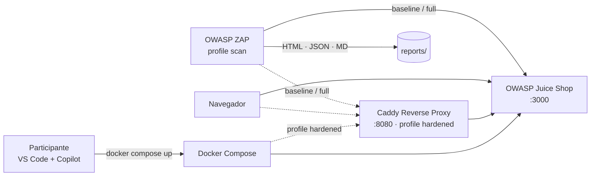
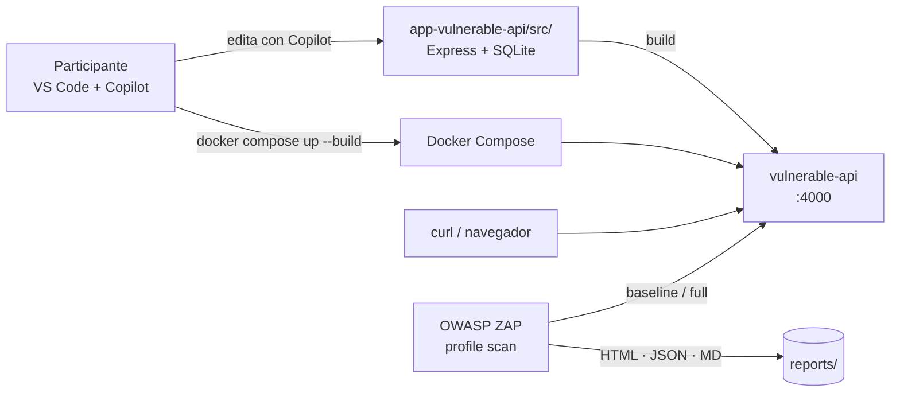

# GitHub Copilot + OWASP ZAP (DAST) Workshop

[](https://github.com/clever-devops-tools/copilot-dast-workshop/actions/workflows/validate.yml)
[](https://github.com/clever-devops-tools/copilot-dast-workshop/actions/workflows/dast-juice-shop.yml)
[](https://github.com/clever-devops-tools/copilot-dast-workshop/actions/workflows/dast-vulnerable-api.yml)

> Laboratorio práctico para aprender a acelerar procesos DevSecOps usando
> **GitHub Copilot** junto con **Dynamic Application Security Testing (DAST)**.

---

## Introducción

Este laboratorio forma parte del workshop **GitHub Copilot + OWASP ZAP (DAST)**.

El objetivo del taller **no** es aprender OWASP ZAP en profundidad, sino
demostrar cómo **GitHub Copilot** puede acelerar significativamente un flujo
DevSecOps al escribir configuraciones, workflows, scripts y remediaciones
relacionadas con seguridad dinámica de aplicaciones.

El laboratorio incluye **dos escenarios end-to-end**:

- **Escenario A**: OWASP Juice Shop (código de terceros) remediado con un
  reverse proxy Caddy que Copilot ayuda a construir.
- **Escenario B**: `vulnerable-api` (código propio) con SQLi, XSS,
  command injection y path traversal, remediados en el código fuente
  con Copilot.

Ambos escenarios corren en Docker Compose local y en GitHub Actions.

---

## Objetivos

Al finalizar el laboratorio el participante será capaz de:

- Levantar apps vulnerables con **Docker Compose** e integrar OWASP ZAP
  para escaneos DAST (baseline y full).
- Automatizar el escaneo en **GitHub Actions** con un workflow reutilizable
  y wrappers por app.
- Usar **GitHub Copilot Chat** para interpretar reportes ZAP y generar el
  fix: cuando no tenés el código (proxy/headers) y cuando sí lo tenés
  (refactor de rutas Express).
- Comparar los hallazgos antes/después para medir el impacto real de las
  remediaciones.

---

## Arquitectura

El laboratorio contiene **dos escenarios** independientes con la misma
orquestación de Docker Compose. Cada uno enseña un enfoque distinto de
remediación asistida por Copilot.

### Escenario A — Juice Shop (sin acceso al código)

Target de terceros; la remediación se hace **desde afuera** con un
reverse proxy Caddy que inyecta headers de seguridad.



Flujo típico: escaneo → hallazgos de headers → Copilot Chat genera el
`Caddyfile` → segundo escaneo contra `:8080` → hallazgos reducidos.

### Escenario B — Vulnerable API (con acceso al código)

App propia con vulnerabilidades incrustadas (SQLi, XSS, CmdInjection,
PathTraversal). La remediación se hace **en el código fuente** y se
rebuildea el contenedor.



Flujo típico: exploit con `curl` → Copilot Chat refactoriza la ruta
vulnerable → `docker compose up -d --build vulnerable-api` → exploit
falla → escaneo confirma.

### Componentes comunes

| Componente        | Rol                                                        |
| ----------------- | ---------------------------------------------------------- |
| Docker Compose    | Orquesta todos los servicios del laboratorio.              |
| OWASP ZAP         | Escáner DAST (baseline / full); perfil `scan` on-demand.   |
| GitHub Actions    | Workflow `dast` que corre ambos escenarios en CI (matrix). |

---

## Requisitos

Antes de iniciar el laboratorio asegúrate de tener instalado:

- [Docker Desktop](https://www.docker.com/products/docker-desktop/) (con Docker Compose v2).
- [Git](https://git-scm.com/downloads).
- [Visual Studio Code](https://code.visualstudio.com/).
- [GitHub Copilot](https://github.com/features/copilot) habilitado en VS Code.

Verifica tu instalación:

```bash
docker --version
docker compose version
git --version
code --version
```

---

## Instalación

1. Clona el repositorio:

   ```bash
   git clone https://github.com/clever-devops-tools/copilot-dast-workshop.git
   cd copilot-dast-workshop
   ```

2. Abre el proyecto en Visual Studio Code:

   ```bash
   code .
   ```

3. Asegúrate de que Docker Desktop esté en ejecución.

---

## Ejecución

Levanta el laboratorio con Docker Compose:

```bash
docker compose up -d
```

Alternativamente, puedes usar los scripts incluidos:

- **macOS / Linux:** `./scripts/start.sh`
- **Windows (PowerShell):** `./scripts/start.ps1`

---

## Verificación

1. Comprueba que el contenedor está en ejecución:

   ```bash
   docker compose ps
   ```

   Deberías ver el servicio `juice-shop` con estado `running` (healthy).

2. Abre la aplicación en tu navegador:

   <http://localhost:3000>

3. Si todo funciona correctamente, verás la página principal de
   **OWASP Juice Shop**.

---

## Escaneo DAST con OWASP ZAP

El laboratorio incluye un servicio `zap` en `docker-compose.yml` bajo el
perfil `scan`. Se ejecuta bajo demanda y no arranca con `docker compose up`.

Ejecutar un escaneo **baseline** (rápido, pasivo):

```bash
./scripts/scan.sh
# o
docker compose --profile scan run --rm zap
```

Ejecutar un **full scan** (activo, tarda más):

```bash
./scripts/scan.sh full
```

En Windows (PowerShell):

```powershell
./scripts/scan.ps1
./scripts/scan.ps1 full
```

Los reportes se generan en [`reports/`](reports/) en formatos HTML, JSON y
Markdown. Las reglas personalizadas viven en [`zap/rules.tsv`](zap/rules.tsv).

---

## DAST en GitHub Actions

El repositorio incluye **un workflow por aplicación** para que cada uno
tenga su propio badge de estado, más un workflow reutilizable con la
lógica compartida.

| Workflow                                                                                | Rol                                                    |
| --------------------------------------------------------------------------------------- | ------------------------------------------------------ |
| [`dast-juice-shop`](.github/workflows/dast-juice-shop.yml)                              | Escanea OWASP Juice Shop.                              |
| [`dast-vulnerable-api`](.github/workflows/dast-vulnerable-api.yml)                      | Escanea la `vulnerable-api`.                           |
| [`_dast-reusable`](.github/workflows/_dast-reusable.yml)                                | Lógica compartida (`workflow_call`); no se lanza sola. |

### Triggers

Ambos wrappers usan el mismo esquema:

| Evento                        | Acción                                                     |
| ----------------------------- | ---------------------------------------------------------- |
| `workflow_dispatch`           | Ejecución manual (elegir `scan_type`: baseline o full).    |
| `pull_request` sobre `main`   | Cambios en `docker-compose.yml`, `zap/**`, sus paths propios o el reusable. |
| `schedule` (lunes 06:00 UTC)  | Escaneo semanal automatizado.                              |

### Ejecución manual

Desde la pestaña **Actions** del repositorio:

1. Selecciona **dast-juice-shop** o **dast-vulnerable-api**.
2. `Run workflow` → elige `scan_type` (`baseline` o `full`).
3. Al finalizar, descarga los reportes desde la sección **Artifacts** del run
   (`zap-<scan_type>-<target>`).

---

## Remediación con GitHub Copilot

El laboratorio cubre **dos enfoques complementarios** de remediación DAST
con Copilot:

| Enfoque | Cuándo aplica                                | App demo                        | Fix        | Guía completa | Cheat sheet de prompts |
| ------- | --------------------------------------------- | ------------------------------- | ---------- | ------------- | ---------------------- |
| **A**   | No tenemos el código (SaaS, imagen de 3ros)   | OWASP Juice Shop (`:3000`)      | Reverse proxy Caddy con security headers | [docs/Remediation.md](docs/Remediation.md) | [docs/prompts/scenario-a.md](docs/prompts/scenario-a.md) |
| **B**   | Tenemos el código (app propia)               | `vulnerable-api` (`:4000`)      | Refactor con `execFile`, prepared stmts, escape HTML, `path.resolve` | [docs/RemediationCode.md](docs/RemediationCode.md) | [docs/prompts/scenario-b.md](docs/prompts/scenario-b.md) |

Uso rápido del enfoque A:

```bash
# Levantar el reverse proxy endurecido
docker compose --profile hardened up -d proxy

# Escanear contra el proxy en lugar de la app directa
./scripts/scan.sh baseline http://proxy:8080
```

Resultado medido: `WARN-NEW` **7 → 4**, `PASS` **59 → 62**.

Uso rápido del enfoque B:

```bash
# La app queda accesible en http://localhost:4000
docker compose up -d vulnerable-api

# Explotar la SQLi (antes del fix)
curl -sG "http://localhost:4000/users/search" --data-urlencode "name=' OR '1'='1"
```

Luego seguir el guión por vulnerabilidad de
[docs/RemediationCode.md](docs/RemediationCode.md).

---

## Reproducibilidad

Todos los componentes del laboratorio están **pineados a versiones exactas**
para que los resultados del escaneo, las tablas antes/después y los prompts
de Copilot se puedan reproducir hoy y dentro de un año.

| Componente          | Versión pineada     |
| ------------------- | ------------------- |
| OWASP Juice Shop    | `v20.1.1`           |
| OWASP ZAP           | `2.17.0`            |
| Caddy               | `2.11.4-alpine`     |
| Node.js (base API)  | `20.20-slim`        |
| Deps npm de la API  | `package-lock.json` (`npm ci`) |

El workflow [`validate`](.github/workflows/validate.yml) falla si:

- Alguna `image:` en `docker-compose.yml` usa un tag móvil
  (`latest`, `stable`, `edge`).
- `package.json` y `package-lock.json` de la API están desincronizados
  (`npm ci --dry-run`).

Detalles completos y guía para actualizar versiones en
[docs/Reproducibility.md](docs/Reproducibility.md).

---

## Limpieza

Detener los contenedores manteniendo los datos:

```bash
docker compose stop
```

Detener y eliminar los contenedores, redes y volúmenes creados:

```bash
docker compose down -v
```

También puedes usar los scripts incluidos:

- **macOS / Linux:** `./scripts/stop.sh` o `./scripts/cleanup.sh`
- **Windows (PowerShell):** `./scripts/stop.ps1` o `./scripts/cleanup.ps1`

---

## Estructura del repositorio

```text
copilot-dast-workshop/
├── README.md              # Este archivo
├── LICENSE                # Licencia del laboratorio
├── .gitignore             # Reglas de exclusión de Git
├── docker-compose.yml     # Servicios: juice-shop, vulnerable-api, proxy, zap
├── app-vulnerable-api/    # API Node.js con 4 vulnerabilidades (Escenario B)
├── proxy/                 # Caddyfile con security headers (Escenario A)
├── zap/                   # Reglas ZAP (rules.tsv)
├── scripts/               # scan.sh/ps1, start/stop/cleanup
├── reports/               # Reportes generados por ZAP (gitignored)
├── docs/                  # Guías del workshop y cheat sheets de prompts
└── .github/workflows/     # validate + dast-juice-shop + dast-vulnerable-api
                            #   + _dast-reusable (workflow_call)
```

---

## Próximos pasos

El laboratorio está completo para el workshop. Extensiones opcionales para
profundizar después del taller:

- **Publicar SARIF en la pestaña Security**: convertir el JSON de ZAP a
  SARIF y subirlo con `github/codeql-action/upload-sarif` para que los
  hallazgos aparezcan como code scanning alerts.
- **Escaneos autenticados**: configurar un contexto ZAP con login
  (form-based) para que el full-scan recorra rutas detrás del auth de
  Juice Shop.
- **Pinnear GitHub Actions por SHA** (no solo por tag) para hardening
  de supply-chain — ver [docs/Reproducibility.md](docs/Reproducibility.md).
- **Añadir más vulnerabilidades** al `vulnerable-api` (SSRF, XXE,
  IDOR…) siguiendo el mismo patrón "un endpoint = una vuln".
- **Complementar con SAST/SCA**: agregar CodeQL y `npm audit` /
  Dependabot al pipeline para mostrar la diferencia entre estático y
  dinámico.
- **Endpoint hardened en Kubernetes**: reescribir el proxy Caddy como
  Ingress con las mismas anotaciones para mostrar que el patrón escala.

---

## Licencia

Distribuido bajo la licencia MIT. Consulta [LICENSE](LICENSE) para más detalles.
