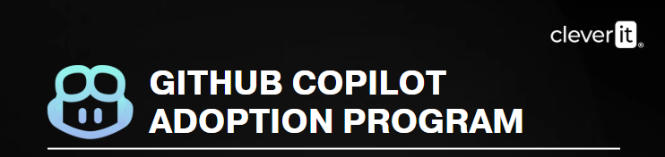
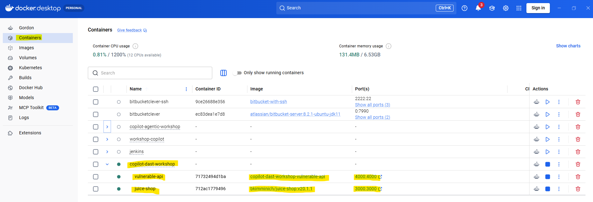
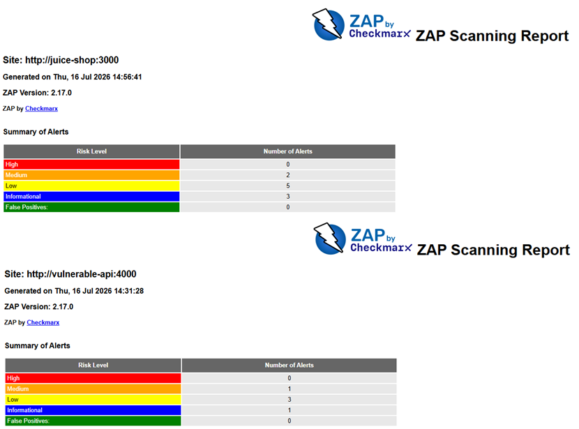
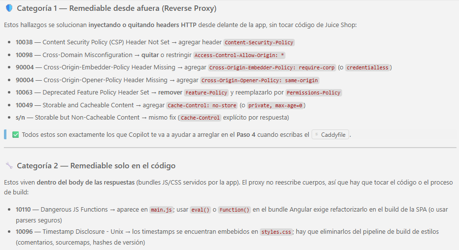
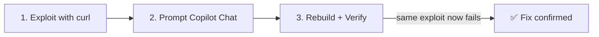
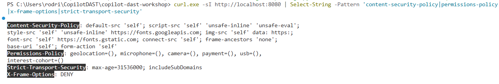
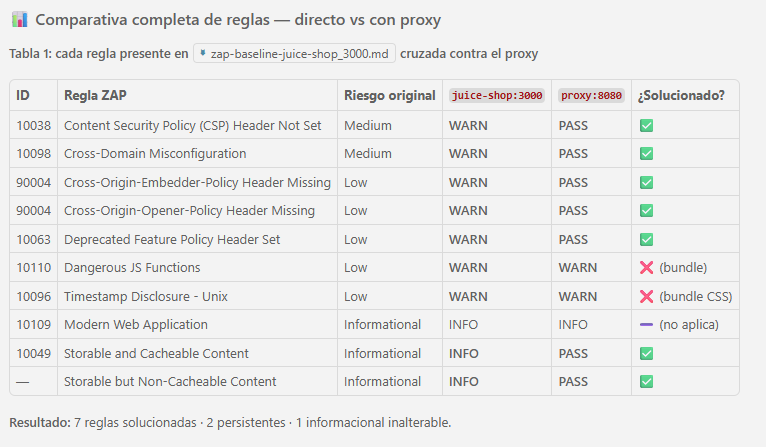
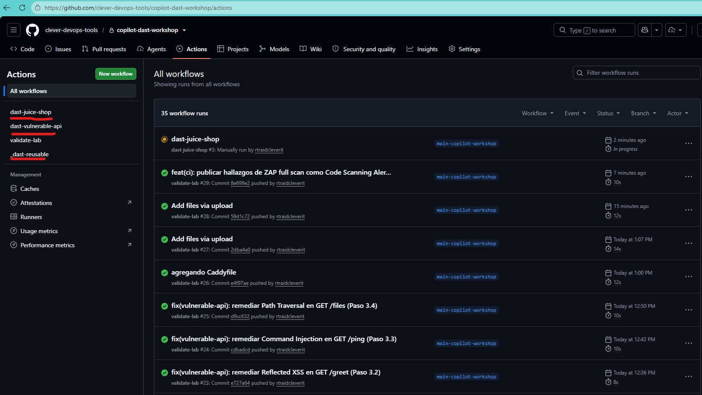

<div align="center">
  

  # Copilot for DAST Security Vulnerabilities with ZAP Proxy

  [](https://github.com/features/copilot)
  [](https://www.zaproxy.org/)
  [](https://nodejs.org/)
  [](https://www.docker.com/)
</div>

---

**This hands-on training** will teach you how to **accelerate remediation of Dynamic Application Security Testing (DAST) findings** using **GitHub Copilot Chat** on reports generated by **OWASP ZAP Proxy**. We cover the two most common real-world scenarios: when **you have the source code** (assisted refactor) and when **you don't** (reverse proxy mitigation).

> For more information about the tools used in this workshop, check the official documentation:
>
> - [GitHub Copilot Chat](https://docs.github.com/en/copilot/how-tos/use-copilot-chat)
> - [OWASP ZAP](https://www.zaproxy.org/docs/)
> - [ZAP Baseline Scan](https://www.zaproxy.org/docs/docker/baseline-scan/)
> - [ZAP Full Scan](https://www.zaproxy.org/docs/docker/full-scan/)
> - [OWASP Top 10](https://owasp.org/Top10/)
> - [DAST in the SDLC](https://owasp.org/www-project-devsecops-guideline/latest/02b-Dynamic-Application-Security-Testing)

---

## 📋 Table of Contents

1. [🚀 Run the application](#-run-the-application)
2. [🔍 Step 1. First DAST scan with OWASP ZAP](#-step-1-first-dast-scan-with-owasp-zap)
3. [🧠 Step 2. Analyze the report with GitHub Copilot Chat](#-step-2-analyze-the-report-with-github-copilot-chat)
4. [🔧 Step 3. Remediate vulnerabilities in code with Copilot](#-step-3-remediate-vulnerabilities-in-code-with-copilot)
   - [3.1 SQL Injection](#31-sql-injection)
   - [3.2 Reflected XSS](#32-reflected-xss)
   - [3.3 Command Injection](#33-command-injection)
   - [3.4 Path Traversal](#34-path-traversal)
5. [🛡️ Step 4. Remediate without code access (Reverse Proxy)](#️-step-4-remediate-without-code-access-reverse-proxy)
6. [🔁 Step 5. Re-scan and compare before/after](#-step-5-re-scan-and-compare-beforeafter)
7. [🤖 Step 6. Automate DAST with GitHub Actions (Bonus)](#-step-6-automate-dast-with-github-actions-bonus)

---

## ⏱️ Estimated duration

| Block                                                  | Time        |
| ------------------------------------------------------ | ----------- |
| 🚀 Setup and application startup                       | 10 min      |
| 🔍 Step 1 - First DAST scan                            | 10 min      |
| 🧠 Step 2 - Report analysis with Copilot               | 10 min      |
| 🔧 Step 3 - In-code remediation (4 vulnerabilities)    | 30 min      |
| 🛡️ Step 4 - Reverse proxy remediation                  | 15 min      |
| 🔁 Step 5 - Re-scan and comparison                     | 10 min      |
| 🤖 Step 6 - Bonus GitHub Actions                        | 5 min       |
| **Total**                                              | **~90 min** |

---

## 🎯 Learning objectives

By the end of this workshop you will be able to:

- ✅ Run a **baseline** and **full** DAST scan with **OWASP ZAP** against two targets: an in-house API with source code available and a third-party app (Juice Shop).
- ✅ Use **GitHub Copilot Chat** to **interpret ZAP findings** and prioritize remediations.
- ✅ Apply the **direct approach** (code refactor) to eliminate SQLi, XSS, Command Injection, and Path Traversal.
- ✅ Apply the **indirect approach** (Caddy reverse proxy) when the code is not yours.
- ✅ Verify remediation impact with a **second scan** and compare before/after metrics.
- ✅ Automate the DAST flow in a **GitHub Actions pipeline**.

---

## 📚 Prerequisites

Before you start, make sure you have:

- [Docker Desktop](https://www.docker.com/products/docker-desktop/) installed and running (with Docker Compose v2).
- [Git](https://git-scm.com/downloads).
- [Visual Studio Code](https://code.visualstudio.com/).
- [GitHub Copilot](https://github.com/features/copilot) active in VS Code (extension + subscription).
- A terminal with `curl` available (native on macOS/Linux; on Windows it ships with Git Bash or PowerShell 7+).

Verify your installation:

```bash
docker --version
docker compose version
git --version
code --version
```

---

## 🚀 Run the application

To get the lab up and running you have two options:

1. **Manual execution:** Check the [about.md](./about.md) page, where you will find the detailed steps and a description of the services that get started.
2. **Copilot Agent assistance:** You can ask the agent to handle the execution. Open the chat in your editor in agent mode and use a prompt like the following:

    > "Analyze the project structure and execute the necessary commands to start the DAST lab using Docker Compose."

This workshop launches **two vulnerable applications** and **one DAST scanner** via Docker Compose:

- **`vulnerable-api`** — Node.js/Express API with 4 vulnerabilities from the OWASP Top 10 (in-house source code).
- **`juice-shop`** — OWASP Juice Shop, third-party application used for the "no source code" scenario.
- **`zap`** — OWASP ZAP as the DAST scanner (on-demand with the `scan` profile).
- **`proxy`** — Caddy reverse proxy with security headers (on-demand with the `hardened` profile).

### Quick commands

```bash
# Start the lab
docker compose up -d

# Check that everything is running
docker compose ps
```

> [!IMPORTANT]
> **Running the workshop again?** `docker compose up -d` reuses the local `copilot-dast-workshop-vulnerable-api` image if it already exists. Because the `Dockerfile` does `COPY src ./src`, that image preserves the source code **exactly as it was when you built it** — if you already applied the Step 3 fixes in a previous run, the exploits in Step 3.1 will return `{"results":[]}` instead of exposing the vulnerability. To start from the original vulnerable state, force a rebuild:
>
> ```bash
> docker compose up -d --build vulnerable-api
> ```
>
> Or wipe everything with `./scripts/cleanup.sh` / `./scripts/cleanup.ps1` (removes containers, networks, and volumes) and bring the lab back up with `docker compose up -d --build`.

Alternatively, you can use the included scripts:

| Platform         | Start                 | Stop                 | Clean up                |
| ---------------- | --------------------- | -------------------- | ----------------------- |
| macOS / Linux    | `./scripts/start.sh`  | `./scripts/stop.sh`  | `./scripts/cleanup.sh`  |
| Windows (pwsh)   | `./scripts/start.ps1` | `./scripts/stop.ps1` | `./scripts/cleanup.ps1` |

### Lab URLs

| Service            | URL                       | Notes                                             |
| ------------------ | ------------------------- | ------------------------------------------------- |
| `vulnerable-api`   | <http://localhost:4000>   | Vulnerable endpoints (in-house code scenario).    |
| `juice-shop`       | <http://localhost:3000>   | Third-party app (no source code scenario).       |
| Hardened `proxy`   | <http://localhost:8080>   | Only after `--profile hardened` in Step 4.        |



---

## 🔍 Step 1. First DAST scan with OWASP ZAP

**Goal:** run a **baseline** scan with OWASP ZAP against both applications and get the initial report we will use as our baseline.

> [!NOTE]
> ZAP's `baseline` scan is **passive** (fast, ~2 min) and only analyzes the HTTP responses it finds while crawling. The `full-scan` is **active**: it sends real SQLi, XSS, and other payloads. We start with baseline for fast results.

> [!IMPORTANT]
> **Shell convention in this workshop:** blocks labeled `bash` use `\` for line continuation (macOS / Linux / Git Bash). Blocks labeled `powershell` use backtick `` ` `` (Windows PowerShell / pwsh). Copy the block that matches your terminal.

### 1.1 Scan `vulnerable-api` (in-house code)

```bash
# macOS / Linux
./scripts/scan.sh baseline http://vulnerable-api:4000
```

```powershell
# Windows (PowerShell)
./scripts/scan.ps1 baseline http://vulnerable-api:4000
```

You can also invoke Docker Compose directly. Pick the block that matches your shell:

```bash
# Bash / zsh (macOS / Linux): line continuation with `\`
docker compose --profile scan run --rm zap \
  zap-baseline.py -t http://vulnerable-api:4000 \
  -c /zap/config/rules.tsv \
  -r zap-baseline-vulnerable-api_4000.html \
  -J zap-baseline-vulnerable-api_4000.json \
  -w zap-baseline-vulnerable-api_4000.md -I
```

```powershell
# PowerShell (Windows): line continuation with backtick `` ` ``
docker compose --profile scan run --rm zap `
  zap-baseline.py -t http://vulnerable-api:4000 `
  -c /zap/config/rules.tsv `
  -r zap-baseline-vulnerable-api_4000.html `
  -J zap-baseline-vulnerable-api_4000.json `
  -w zap-baseline-vulnerable-api_4000.md -I
```

### 1.2 Scan `juice-shop` (third-party code)

```bash
# macOS / Linux
./scripts/scan.sh baseline http://juice-shop:3000
```

```powershell
# Windows (PowerShell)
./scripts/scan.ps1 baseline http://juice-shop:3000
```

### 1.3 Review the reports

> [!NOTE]
> Reports only exist **after running the scans** from 1.1 (`vulnerable-api`) and/or 1.2 (`juice-shop`). The filename includes the target slug (e.g., `zap-baseline-vulnerable-api_4000.html`, `zap-baseline-juice-shop_3000.html`). If the file you're trying to open "doesn't exist", go back to the previous step and run the corresponding scan first.

Reports are generated in the [`reports/`](./reports/) folder in three formats:

| File                                                   | Suggested use                            |
| ------------------------------------------------------ | ---------------------------------------- |
| `zap-baseline-<target>.html`                           | Open it in a browser for review.         |
| `zap-baseline-<target>.json`                           | Programmatic ingestion (dashboards).     |
| `zap-baseline-<target>.md`                             | Share in PRs and use with Copilot Chat.  |

List the reports available in your folder:

```bash
# macOS / Linux
ls -1 reports/zap-*.html reports/zap-*.json reports/zap-*.md 2>/dev/null
```

```powershell
# Windows (PowerShell)
Get-ChildItem reports\zap-*.html, reports\zap-*.json, reports\zap-*.md | Select-Object Name
```

Open the `juice-shop` HTML (replace the filename with whichever one you want to review):

```bash
# macOS / Linux
open reports/zap-baseline-juice-shop_3000.html
```

```powershell
# Windows (PowerShell)
Invoke-Item reports/zap-baseline-juice-shop_3000.html
```

Open the `vulnerable-api` HTML:

```bash
# macOS / Linux
open reports/zap-baseline-vulnerable-api_4000.html
```

```powershell
# Windows (PowerShell)
Invoke-Item reports/zap-baseline-vulnerable-api_4000.html
```



---

## 🧠 Step 2. Analyze the report with GitHub Copilot Chat

**Goal:** instead of reading hundreds of lines of the report manually, we let **GitHub Copilot Chat** interpret the findings and prioritize what to remediate first.

### 2.1 Open the report in VS Code

Open the Markdown file of the report in your editor. For example:

```bash
code reports/zap-baseline-juice-shop_3000.md
```

Markdown is the format Copilot Chat understands best because the context is structured plain text.

### 2.2 Use Copilot Chat to interpret the findings

With the report open, open Copilot Chat (`Ctrl+Alt+I` / `Cmd+Ctrl+I`) and use this prompt:

```text
Analyze this OWASP ZAP report (#file:zap-baseline-juice-shop_3000.md) and generate a Markdown table with the 5 most important vulnerabilities. For each one include:

- Rule ID
- Alert title
- Severity (High/Medium/Low)
- A one-line summary
- Which HTTP header, config, or code change would remediate it
```

**Expected result (approximate, may vary):**

| ID    | Title                              | Severity | Suggested fix                             |
| ----- | ---------------------------------- | -------- | ----------------------------------------- |
| 10038 | Content Security Policy not set    | Medium   | `Content-Security-Policy` header          |
| 10063 | Deprecated Feature-Policy          | Info     | Replace with `Permissions-Policy`         |
| 10098 | Cross-Domain Misconfiguration      | Medium   | Remove `Access-Control-Allow-Origin: *`   |
| 90004 | COEP missing                       | Medium   | `Cross-Origin-Embedder-Policy` header     |
| 10049 | Storable and Cacheable Content     | Info     | `Cache-Control: no-store`                 |

### 2.3 Follow-up prompt: group by fix type

Copilot has already given you an overview. Now ask for an attack plan:

```text
Now group the findings from #file:zap-baseline-juice-shop_3000.md into two categories:

1. Remediable from the outside (missing HTTP headers, cache policy, misconfigured CORS): can be mitigated with a reverse proxy that injects headers.
2. Remediable only in code: application bugs a proxy cannot fix (e.g., dangerous inline JS, endpoints with insecure logic).

Generate two Markdown lists with the corresponding rule IDs.
```

> [!TIP]
> This is the key teaching moment: **Copilot does not guess your team's security policy**. You tell it which headers you want and which type of fix you prefer, and Copilot writes the code. Prompt quality determines fix quality.



---

## 🔧 Step 3. Remediate vulnerabilities in code with Copilot

**Goal:** for each of the 4 canonical vulnerabilities in `vulnerable-api`, we always follow the same 3-step cycle:



The 4 vulnerable endpoints:

| # | Endpoint            | Vulnerability     | OWASP Top 10 | File                                                             |
| - | ------------------- | ----------------- | ------------ | ---------------------------------------------------------------- |
| 1 | `GET /users/search` | SQL Injection     | A03:2021     | [`src/routes/users.js`](./app-vulnerable-api/src/routes/users.js) |
| 2 | `GET /greet`        | Reflected XSS     | A03:2021     | [`src/routes/greet.js`](./app-vulnerable-api/src/routes/greet.js) |
| 3 | `GET /ping`         | Command Injection | A03:2021     | [`src/routes/ping.js`](./app-vulnerable-api/src/routes/ping.js)   |
| 4 | `GET /files`        | Path Traversal    | A01:2021     | [`src/routes/files.js`](./app-vulnerable-api/src/routes/files.js) |

Make sure the app is up **with the current vulnerable source from disk**. Use `--build` to force Docker to rebuild the image and avoid reusing a cached image from a previous run (which might already contain the fixes):

```bash
docker compose up -d --build vulnerable-api
```

> [!TIP]
> If the exploit `curl` commands return `{"results":[]}` or another "clean" output on the very first try, you're almost certainly hitting an image that already has the fixes baked in. Run the `--build` command above and try again.

---

### 3.1 SQL Injection

**Vulnerable endpoint:** `GET /users/search`  · **File:** [`app-vulnerable-api/src/routes/users.js`](./app-vulnerable-api/src/routes/users.js)

#### 1️⃣ Exploit the vulnerability

```bash
curl -sG "http://localhost:4000/users/search" --data-urlencode "name=' OR '1'='1"
```

> [!TIP]
> In **Windows PowerShell 5.1** the name `curl` is an alias for `Invoke-WebRequest`. If when you copy the command you see an error about `--data-urlencode` not being recognized, use `curl.exe` instead of `curl` to invoke the real binary (Windows 10+ ships with it).

This returns **every** user (including `admin`) because the `OR '1'='1'` condition bypasses the filter.

#### 2️⃣ Copilot Chat prompt

Open [`app-vulnerable-api/src/routes/users.js`](./app-vulnerable-api/src/routes/users.js) in VS Code and paste the following prompt in Copilot Chat:

```text
The file #file:app-vulnerable-api/src/routes/users.js is vulnerable to SQL Injection because it concatenates the `name` parameter directly into the query. Refactor it to:

1. Use prepared statements with parameter binding (better-sqlite3 supports `?`).
2. Keep the substring search (`LIKE %...%`).
3. Do NOT return the raw query to the client in the response.
4. Return 400 if `name` is longer than 100 characters.
```

**Accept the change proposed by Copilot** and save the file.

#### 3️⃣ Verify the fix

```bash
docker compose up -d --build vulnerable-api
curl -sG "http://localhost:4000/users/search" --data-urlencode "name=' OR '1'='1"
# → {"results":[]}   (the string is searched literally, no bypass)

curl -sG "http://localhost:4000/users/search" --data-urlencode "name=alice"
# → {"results":[{"id":1,"name":"alice","email":"alice@example.com"}]}
```

---

### 3.2 Reflected XSS

**Vulnerable endpoint:** `GET /greet`  · **File:** [`app-vulnerable-api/src/routes/greet.js`](./app-vulnerable-api/src/routes/greet.js)

#### 1️⃣ Exploit the vulnerability

```bash
curl -sG "http://localhost:4000/greet" --data-urlencode "name=<script>alert(1)</script>"
```

The `<script>` is reflected as-is inside the returned HTML and gets executed in the victim's browser.

#### 2️⃣ Copilot Chat prompt

Open [`app-vulnerable-api/src/routes/greet.js`](./app-vulnerable-api/src/routes/greet.js) and use this prompt:

```text
The file #file:app-vulnerable-api/src/routes/greet.js suffers from Reflected XSS because it interpolates `name` into HTML without escaping. Refactor it to:

1. Escape HTML entities (<, >, ", ', &) before rendering the name.
2. Do NOT use external libraries — implement a small `escapeHtml` function inside the file.
3. Limit `name` to 50 characters, returning 400 if it exceeds that.
```

#### 3️⃣ Verify the fix

```bash
# Bash / zsh
docker compose up -d --build vulnerable-api
curl -sG "http://localhost:4000/greet" --data-urlencode "name=<script>alert(1)</script>" | grep -c '<script>'
# → 0   (the <script> is encoded as &lt;script&gt;)
```

```powershell
# PowerShell: Select-String replaces grep; curl.exe avoids the alias to Invoke-WebRequest
docker compose up -d --build vulnerable-api
(curl.exe -sG "http://localhost:4000/greet" --data-urlencode "name=<script>alert(1)</script>" | Select-String '<script>').Count
# → 0   (the <script> is encoded as &lt;script&gt;)
```

---

### 3.3 Command Injection

**Vulnerable endpoint:** `GET /ping`  · **File:** [`app-vulnerable-api/src/routes/ping.js`](./app-vulnerable-api/src/routes/ping.js)

#### 1️⃣ Exploit the vulnerability

```bash
curl -sG "http://localhost:4000/ping" --data-urlencode "host=127.0.0.1;id"
```

When the ping finishes, the `;id` is executed as an additional command and returns `uid=1000(node) gid=1000(node)...`.

#### 2️⃣ Copilot Chat prompt

Open [`app-vulnerable-api/src/routes/ping.js`](./app-vulnerable-api/src/routes/ping.js) and use this prompt:

```text
The file #file:app-vulnerable-api/src/routes/ping.js is vulnerable to Command Injection because it interpolates `host` into a string that runs through a shell. Refactor it to:

1. Replace `child_process.exec` with `child_process.execFile` (no shell).
2. Validate that `host` matches a conservative regex: only letters, digits, dots, and hyphens; maximum 253 characters.
3. Reject with 400 "invalid host" if the regex does not match.
4. Keep the 3-second timeout.
5. Do not return the full `stderr` to the client to avoid leaking system details.
```

#### 3️⃣ Verify the fix

```bash
docker compose up -d --build vulnerable-api

# Exploit attempt → rejected
curl -sG "http://localhost:4000/ping" --data-urlencode "host=127.0.0.1;id"
# → invalid host

# Legitimate use → still works
curl -sG "http://localhost:4000/ping" --data-urlencode "host=127.0.0.1"
# → PING 127.0.0.1 ...
```

---

### 3.4 Path Traversal

**Vulnerable endpoint:** `GET /files`  · **File:** [`app-vulnerable-api/src/routes/files.js`](./app-vulnerable-api/src/routes/files.js)

#### 1️⃣ Exploit the vulnerability

```bash
curl -sG "http://localhost:4000/files" --data-urlencode "name=../../../../etc/passwd"
```

This returns the actual content of `/etc/passwd` from the container because `path.join` **normalizes but does not restrict** `..`.

#### 2️⃣ Copilot Chat prompt

Open [`app-vulnerable-api/src/routes/files.js`](./app-vulnerable-api/src/routes/files.js) and use this prompt:

```text
The file #file:app-vulnerable-api/src/routes/files.js is vulnerable to Path Traversal. Refactor it to:

1. Reject with 400 "invalid name" if `name` contains path separators (`/`, `\`) or `..` sequences.
2. Resolve the final path with `path.resolve(BASE_DIR, name)`.
3. Verify that the resolved path starts with `BASE_DIR + path.sep`; if not, reject with 400.
4. Return 404 "not found" when the file does not exist, without leaking filesystem details.
```

#### 3️⃣ Verify the fix

```bash
docker compose up -d --build vulnerable-api

# Escape attempt → rejected
curl -sG "http://localhost:4000/files" --data-urlencode "name=../../../../etc/passwd"
# → invalid name

# Legitimate use → still works
curl -sG "http://localhost:4000/files" --data-urlencode "name=hello.txt"
# → Hello from vulnerable-api!
```

> [!TIP]
> **Bonus prompt:** when you're done fixing the 4 routes, ask Copilot to review them all together with a prompt like:
>
> ```text
> Review the four files #file:src/routes/users.js #file:src/routes/greet.js #file:src/routes/ping.js #file:src/routes/files.js and suggest a common Express middleware that applies basic rate-limiting and failed-attempt logging, to make it harder to enumerate vulnerabilities.
> ```

---

## 🛡️ Step 4. Remediate without code access (Reverse Proxy)

**Goal:** when the vulnerable code **is NOT yours** (SaaS, third-party image, legacy monolith), Copilot helps you build a **Caddy reverse proxy** that injects the missing security headers **in front of** the application.

This is exactly the pattern you'd use in production with a **WAF** or a **hardened Ingress** in Kubernetes.

### 4.1 Interpret the header findings

The typical WARN findings from the Juice Shop baseline scan are all about **missing HTTP headers** (CSP, COEP, Permissions-Policy, etc.). Ideally you already identified them in Step 2.

### 4.2 Generate the `Caddyfile` with Copilot

Open Copilot Chat with the report as context and use this prompt:

```text
Based on the findings from #file:zap-baseline-juice-shop_3000.md, generate a `Caddyfile` for Caddy 2 that acts as a reverse proxy in front of `http://juice-shop:3000`, listens on port 8080, and adds the following security response headers:

- Content-Security-Policy (compatible with an Angular SPA that uses inline styles and JIT)
- Cross-Origin-Embedder-Policy: credentialless
- Cross-Origin-Opener-Policy: same-origin
- Cross-Origin-Resource-Policy: same-origin
- Permissions-Policy with geolocation, microphone, camera, payment, usb, interest-cohort disabled
- Referrer-Policy: strict-origin-when-cross-origin
- X-Content-Type-Options: nosniff
- X-Frame-Options: DENY
- Strict-Transport-Security: max-age=31536000; includeSubDomains
- Cache-Control: no-store

Also strip the `Server`, `X-Powered-By`, `Feature-Policy`, and `Access-Control-Allow-Origin` headers that come from the upstream. Disable automatic HTTPS and Caddy's admin API.
```

Save the response to [`proxy/Caddyfile`](./proxy/Caddyfile). If you get stuck, you can compare with the reference file already included in the repo.

### 4.3 Add the `proxy` service to Docker Compose

> [!NOTE]
> This service is already defined in the repo's [`docker-compose.yml`](./docker-compose.yml) under the `hardened` profile. If the file were empty, this prompt tells Copilot how to add it:

```text
Add a service called `proxy` to #file:docker-compose.yml using the `caddy:2.11.4-alpine` image. Requirements:

- It must be under the `hardened` profile (does not start with default `docker compose up`).
- Depends on `juice-shop` with `condition: service_healthy`.
- Mount `./proxy/Caddyfile` as `/etc/caddy/Caddyfile` in read-only mode.
- Expose port 8080:8080.
- Attach to the `dast-lab` network.
- `container_name: proxy`.
```

### 4.4 Start the hardened proxy

```bash
docker compose --profile hardened up -d proxy
```

Verify that it responds with the new headers:

```bash
# Bash / zsh
curl -sI http://localhost:8080 | grep -Ei 'content-security-policy|permissions-policy|x-frame-options|strict-transport-security'
```

```powershell
# PowerShell: Select-String replaces grep; curl.exe avoids the alias to Invoke-WebRequest
curl.exe -sI http://localhost:8080 | Select-String -Pattern 'content-security-policy|permissions-policy|x-frame-options|strict-transport-security'
```



---

## 🔁 Step 5. Re-scan and compare before/after

**Goal:** verify with concrete metrics that the work with Copilot **actually reduced the attack surface**.

### 5.1 Re-scan the hardened proxy (Third-party code scenario)

```bash
# macOS / Linux
./scripts/scan.sh baseline http://proxy:8080
```

```powershell
# Windows (PowerShell)
./scripts/scan.ps1 baseline http://proxy:8080
```

Compare the two files:

| Report                                        | Target                    |
| --------------------------------------------- | ------------------------- |
| `reports/zap-baseline-juice-shop_3000.md`     | Juice Shop direct         |
| `reports/zap-baseline-proxy_8080.md`          | Juice Shop behind proxy   |

**Typical result measured in the lab:**

| Metric     | Direct (`juice-shop:3000`)  | With proxy (`proxy:8080`) | Δ    |
| ---------- | --------------------------- | ------------------------- | ---- |
| `PASS`     | 59                          | 62                        | +3   |
| `WARN-NEW` | 7                           | 4                         | −3   |
| `FAIL-NEW` | 0                           | 0                         | =    |

### 5.2 Re-scan the remediated code (In-house code scenario) with **full-scan**

> [!IMPORTANT]
> The baseline scan is **passive** and does not detect SQLi, XSS, or Command Injection because it doesn't send payloads. To validate Step 3 you need an **active full-scan**. It takes 2–5 min against `vulnerable-api`.

```bash
# macOS / Linux
./scripts/scan.sh full http://vulnerable-api:4000
```

```powershell
# Windows (PowerShell)
./scripts/scan.ps1 full http://vulnerable-api:4000
```

Compare `FAIL-NEW` before and after. You should see a **reduction to zero** of the SQLi, XSS, command-injection, and path-traversal alerts.

### 5.3 Bonus prompt: ask Copilot for an improvement summary

With both reports in your workspace:

```text
Comparing #file:reports/zap-baseline-juice-shop_3000.md and #file:reports/zap-baseline-proxy_8080.md, generate a Markdown table with:

- Each ZAP rule present in the first report
- Its status (WARN / PASS / FAIL) in each report
- A check ✅ / ❌ indicating whether the reverse proxy solved it

At the end, give me an executive paragraph explaining the impact in business terms.
```



---

## 🤖 Step 6. Automate DAST with GitHub Actions (Bonus)

**Goal:** take everything we learned to the pipeline so **every PR** triggers an automated DAST scan without any developer having to remember.

### 6.1 Review the included workflows

The repo already ships **three workflows**:

| Workflow                                                                                | Role                                                    |
| --------------------------------------------------------------------------------------- | ------------------------------------------------------- |
| [`.github/workflows/_dast-reusable.yml`](.github/workflows/_dast-reusable.yml)          | Shared logic (`workflow_call`) — does not run alone.    |
| [`.github/workflows/dast-vulnerable-api.yml`](.github/workflows/dast-vulnerable-api.yml) | Scans `vulnerable-api` in CI (baseline / full).         |
| [`.github/workflows/dast-juice-shop.yml`](.github/workflows/dast-juice-shop.yml)        | Scans `juice-shop` in CI (baseline / full).             |

### 6.2 Configured triggers

Both wrappers use the same schema:

| Event                         | Action                                                       |
| ----------------------------- | ------------------------------------------------------------ |
| `workflow_dispatch`           | Manual execution (choose `scan_type`: baseline or full).     |
| `pull_request` on `main`      | Changes in `docker-compose.yml`, `zap/**`, or the wrapper.   |
| `schedule` (Monday 06:00 UTC) | Automated weekly scan.                                       |

### 6.3 Run manually from GitHub

1. Push your branch to GitHub.
2. In the **Actions** tab of the repository, pick **dast-vulnerable-api** or **dast-juice-shop**.
3. Click **Run workflow** → choose `baseline` or `full`.
4. When it finishes, download the reports from the **Artifacts** section (`zap-<scan_type>-<target>`).

### 6.4 Prompt to extend the pipeline with Copilot

```text
Add to the workflow #file:.github/workflows/_dast-reusable.yml an additional step that, when scan_type is "full", converts the ZAP JSON to SARIF format and uploads it with `github/codeql-action/upload-sarif@v3` so the findings show up as Code Scanning Alerts in the Security tab of the repository.
```



---

## 🧹 Clean up

Stop while keeping the containers:

```bash
docker compose stop
```

Remove everything created (containers, networks, volumes):

```bash
docker compose down -v
```

You can also use the scripts:

- `./scripts/stop.sh` / `./scripts/stop.ps1`
- `./scripts/cleanup.sh` / `./scripts/cleanup.ps1`

---

## 📁 Repository structure

```text
copilot-dast-workshop/
├── README.md              # Workshop guide (Spanish - primary)
├── README_EN.md           # 👈 Workshop guide (English translation)
├── about.md               # Service details and manual execution
├── LICENSE                # MIT License
├── .gitignore
├── docker-compose.yml     # juice-shop + vulnerable-api + proxy + zap
├── app-vulnerable-api/    # 4 endpoints with OWASP Top 10 vulnerabilities
├── proxy/                 # Caddyfile with security headers (Step 4)
├── zap/                   # ZAP rules (rules.tsv)
├── scripts/               # scan / start / stop / cleanup (sh + ps1)
├── reports/               # Generated ZAP reports (gitignored)
├── assets/                # Images referenced in the README
└── .github/workflows/     # validate + dast-juice-shop + dast-vulnerable-api
                           #   + _dast-reusable
```

---

## 🧠 Key takeaways

1. **Copilot doesn't replace your security judgment** — you define which policy to apply; Copilot writes the code for that policy.
2. **Prompt quality determines fix quality** — be specific with constraints (regex, timeouts, HTTP codes, size limits).
3. **A fix is rarely just a `replace`** — for Command Injection and Path Traversal, Copilot usually adds input validation, switches to a safer native API (`execFile` instead of `exec`), and improves HTTP response codes.
4. **Always verify with the same exploit** you used to discover the vulnerability — the fastest feedback loop in the workshop.
5. **The general rule:** if you have the code, fix the root cause; if you don't, mitigate with a proxy/WAF; both strategies are valid and Copilot supports you with both.

---

<div align="center">

**You've reached the end of the workshop! 💫**

If you'd like to go deeper, check the [about.md](./about.md) file for additional details about the services, or ask Copilot to help you **add new vulnerabilities** to `vulnerable-api` (SSRF, XXE, IDOR…) following the same "one endpoint = one vuln" pattern.

</div>

---

## 📜 License

Distributed under the MIT License. See [LICENSE](./LICENSE) for more details.
