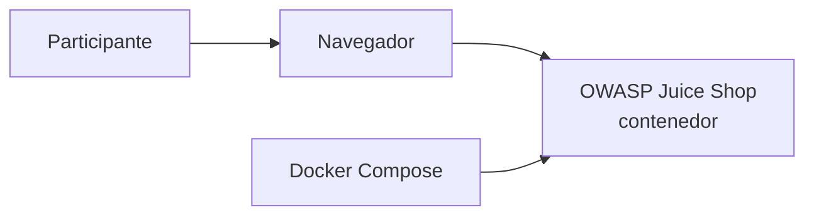

# Arquitectura del laboratorio

> Documento de referencia sobre la arquitectura del laboratorio
> **GitHub Copilot + OWASP ZAP (DAST)**.

## Vision general

En la etapa 1 el laboratorio se compone unicamente de la aplicacion vulnerable
OWASP Juice Shop orquestada mediante Docker Compose.

## Componentes

| Componente        | Rol                                                     |
| ----------------- | ------------------------------------------------------- |
| Docker Compose    | Orquestador local de los servicios del laboratorio.     |
| OWASP Juice Shop  | Aplicacion web intencionalmente vulnerable (target).    |
| Navegador         | Cliente utilizado por el participante para interactuar. |

## Puertos expuestos

| Servicio    | Puerto host | Puerto contenedor |
| ----------- | ----------- | ----------------- |
| juice-shop  | 3000        | 3000              |

## Evolucion (etapas posteriores)

En etapas posteriores del workshop se agregaran:

- Contenedor de OWASP ZAP para escaneos DAST.
- Workflows de GitHub Actions para automatizacion.
- Generacion y publicacion de reportes.
