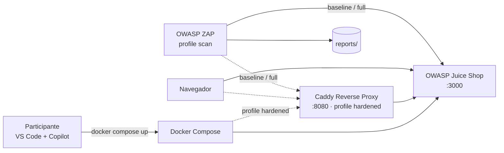
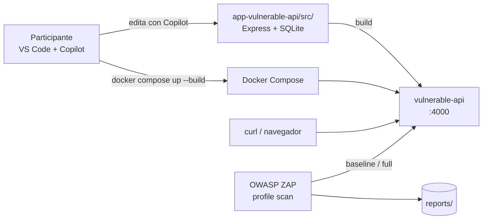

# Arquitectura del laboratorio

> Documento de referencia sobre la arquitectura del laboratorio
> **GitHub Copilot + OWASP ZAP (DAST)**.

## Vision general

El laboratorio se compone de **dos escenarios** independientes que
comparten la misma orquestacion (Docker Compose) y el mismo escaner
(OWASP ZAP). Cada escenario ilustra un enfoque distinto de remediacion
asistida por Copilot.

| Escenario | Target             | Enfoque de remediacion            |
| --------- | ------------------ | --------------------------------- |
| A         | OWASP Juice Shop   | Sin acceso al codigo (proxy)      |
| B         | vulnerable-api     | Con acceso al codigo (refactor)   |

## Escenario A — Juice Shop (sin acceso al codigo)

Copilot ayuda a construir el `Caddyfile` a partir de los hallazgos de
ZAP; no se toca el codigo de Juice Shop.

## Escenario B — Vulnerable API (con acceso al codigo)

Copilot refactoriza el codigo Node/Express (queries parametrizadas,
escape de HTML, whitelist de comandos, contencion de paths); tras un
`--build` el mismo exploit deja de funcionar.

## Componentes

| Componente        | Rol                                                        |
| ----------------- | ---------------------------------------------------------- |
| Docker Compose    | Orquestador local de todos los servicios.                  |
| OWASP Juice Shop  | Aplicacion web intencionalmente vulnerable (escenario A).  |
| vulnerable-api    | API Node/Express con 4 vulnerabilidades (escenario B).     |
| Caddy             | Reverse proxy con headers de seguridad (escenario A).      |
| OWASP ZAP         | Escaner DAST baseline / full; perfil `scan` on-demand.     |
| GitHub Actions    | Workflow `dast` que corre ambos escenarios en CI (matrix). |

## Puertos expuestos

| Servicio        | Puerto host | Puerto contenedor | Perfil         |
| --------------- | ----------- | ----------------- | -------------- |
| juice-shop      | 3000        | 3000              | (siempre)      |
| vulnerable-api  | 4000        | 4000              | (siempre)      |
| proxy (Caddy)   | 8080        | 8080              | `hardened`     |
| zap             | -           | -                 | `scan`         |

## Red

Todos los contenedores viven en la red bridge `dast-lab`, por lo que
ZAP puede resolver `http://juice-shop:3000`, `http://vulnerable-api:4000`
y `http://proxy:8080` por nombre de servicio.

