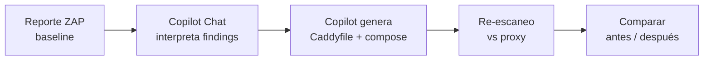

# Remediación asistida por GitHub Copilot — Enfoque A: sin acceso al código

> Guion del **módulo 5a** del workshop.
> Este documento cubre el **primer enfoque** de remediación DAST: cuando
> el código vulnerable **no es tuyo** (SaaS, imagen de terceros, monolito
> legacy) y solo puedes intervenir por delante.
>
> El **segundo enfoque** —arreglar el código en la fuente— está en
> [`RemediationCode.md`](RemediationCode.md).
>
> **Cheat sheet de prompts (copy/paste):**
> [`docs/prompts/scenario-a.md`](prompts/scenario-a.md).

---

## Contexto

En los módulos anteriores levantamos OWASP Juice Shop y ejecutamos un
escaneo baseline de OWASP ZAP. El resultado real (etapa 2a) fue:

```
FAIL-NEW: 0   WARN-NEW: 7   IGNORE: 1   PASS: 59
```

Los 7 hallazgos WARN están todos relacionados con **respuestas HTTP**
(headers faltantes, cache policy, CORS mal configurado). Estos son
casos ideales para remediar con un **reverse proxy** delante de la
aplicación cuando el código de origen no es tuyo (SaaS, imagen de
terceros, monolito legacy). Además es el mismo patrón que usarías con
un WAF o un Ingress endurecido en Kubernetes.

En este módulo el **participante no escribe casi nada de código**:
todo el trabajo lo hace Copilot, guiado por prompts precisos.

---

## Flujo del ejercicio



---

## Prompt 1 — Interpretar el reporte

**Contexto en Copilot Chat:** abrir el archivo `reports/zap-baseline-juice-shop_3000.md`
(o `reports/zap-baseline-report.md` si es el nombre legacy).

> **Prompt:**
> Analiza este reporte de OWASP ZAP y genera una tabla en Markdown con
> las 5 vulnerabilidades más importantes. Para cada una incluye:
> ID de regla, título, severidad, resumen en una línea, y qué header
> HTTP o configuración las remediaría.

**Resultado esperado (aprox.):**

| ID     | Título                             | Sev.  | Fix                                    |
| ------ | ---------------------------------- | ----- | -------------------------------------- |
| 10038  | Content Security Policy no seteado | Med   | Header `Content-Security-Policy`       |
| 10063  | Deprecated Feature-Policy          | Info  | Reemplazar por `Permissions-Policy`    |
| 10098  | Cross-Domain Misconfiguration      | Med   | Remover `Access-Control-Allow-Origin: *` |
| 90004  | COEP faltante                      | Med   | `Cross-Origin-Embedder-Policy`         |
| 10049  | Storable and Cacheable Content     | Info  | `Cache-Control: no-store`              |

---

## Prompt 2 — Generar el Caddyfile

> **Prompt:**
> Genera un `Caddyfile` para Caddy 2 que actúe como reverse proxy delante
> de `http://juice-shop:3000`, escuche en el puerto `8080` y añada los
> siguientes headers de seguridad de respuesta:
>
> - `Content-Security-Policy` (compatible con una SPA Angular que usa
>   inline styles y JIT)
> - `Cross-Origin-Embedder-Policy: credentialless`
> - `Cross-Origin-Opener-Policy: same-origin`
> - `Cross-Origin-Resource-Policy: same-origin`
> - `Permissions-Policy` con `geolocation`, `microphone`, `camera`,
>   `payment`, `usb`, `interest-cohort` deshabilitados
> - `Referrer-Policy: strict-origin-when-cross-origin`
> - `X-Content-Type-Options: nosniff`
> - `X-Frame-Options: DENY`
> - `Strict-Transport-Security: max-age=31536000; includeSubDomains`
> - `Cache-Control: no-store`
>
> También elimina los headers `Server`, `X-Powered-By`, `Feature-Policy`
> y `Access-Control-Allow-Origin` que vienen del upstream. Desactiva
> HTTPS automático y la API admin de Caddy.

El resultado debe parecerse a [`proxy/Caddyfile`](../proxy/Caddyfile).

---

## Prompt 3 — Agregar el servicio al Docker Compose

> **Prompt:**
> Agrega un servicio llamado `proxy` a mi `docker-compose.yml` usando la
> imagen `caddy:2-alpine`. Requisitos:
>
> - Debe estar bajo el perfil `hardened` (no arranca por defecto).
> - Depende de `juice-shop` con `condition: service_healthy`.
> - Monta `./proxy/Caddyfile` como `/etc/caddy/Caddyfile` en modo solo
>   lectura.
> - Expone el puerto `8080:8080`.
> - Se conecta a la red `dast-lab`.
> - `container_name: proxy`.

El resultado debe parecerse al bloque `proxy:` de [`docker-compose.yml`](../docker-compose.yml).

---

## Prompt 4 — Re-escanear el target endurecido

> **Prompt:**
> Extiende `scripts/scan.sh` para que acepte un segundo argumento opcional
> con el target (default `http://juice-shop:3000`). Si el target contiene
> la palabra `proxy`, levanta también el servicio `proxy` con el perfil
> `hardened`. Genera reportes cuyo nombre incluya un slug del target
> (ej. `zap-baseline-proxy_8080.md`).

El resultado debe parecerse a [`scripts/scan.sh`](../scripts/scan.sh).

---

## Ejecución de la demo

```bash
# 1. Escaneo original (baseline directo contra juice-shop)
./scripts/scan.sh baseline

# 2. Levantar el proxy endurecido
docker compose --profile hardened up -d proxy

# 3. Re-escaneo contra el proxy
./scripts/scan.sh baseline http://proxy:8080
```

Comparar los dos archivos generados en `reports/`:

| Reporte                                       | Target                    |
| --------------------------------------------- | ------------------------- |
| `zap-baseline-juice-shop_3000.md`             | Juice Shop directo        |
| `zap-baseline-proxy_8080.md`                  | Juice Shop tras el proxy  |

**Resultado medido en el laboratorio:**

| Métrica    | Directo (juice-shop:3000) | Con proxy (proxy:8080) | Δ    |
| ---------- | ------------------------- | ---------------------- | ---- |
| `PASS`     | 59                        | 62                     | +3   |
| `WARN-NEW` | 7                         | 4                      | −3   |
| `FAIL-NEW` | 0                         | 0                      | =    |

Los WARN residuales tras aplicar el proxy suelen ser:

- `10055 CSP: Wildcard Directive` — aparece porque nuestro CSP usa
  `img-src ... https:` (wildcard de esquema). Se puede endurecer
  (ver Prompt 5).
- `10109 Modern Web Application` — informativo, no remediable por proxy.
- `10110 Dangerous JS Functions` — está en el bundle de la app, no en headers.

Estos son ejemplos perfectos para explicar el **límite del reverse
proxy**: cuando el código sí es tuyo, hay que arreglarlo en origen.

---

## Prompts adicionales (opcionales)

### Prompt 5 — Diagnóstico funcional del CSP

> **Prompt:**
> Abrí `http://localhost:8080` en el navegador y en la consola veo estos
> errores CSP: `[pegar los errores]`. Ajusta la directiva
> `Content-Security-Policy` del `Caddyfile` para permitirlos manteniendo
> la política lo más restrictiva posible.

### Prompt 6 — Migrar a headers en la app

> **Prompt:**
> Suponiendo que Juice Shop fuera nuestro código (Express + Angular),
> genera un middleware Express que aplique exactamente los mismos
> headers que hoy inyecta el `Caddyfile`. Usa `helmet` como base.

### Prompt 7 — Endurecer la política

> **Prompt:**
> Revisa el `Caddyfile` y sugiere una versión más estricta del CSP
> que reemplace `'unsafe-inline'` y `'unsafe-eval'` por hashes o
> nonces. Explica qué cambios haría falta en el frontend Angular.

---

## Puntos didácticos para el instructor

1. **Copilot no adivina las políticas**: se le indican explícitamente los
   headers y valores esperados. La calidad del prompt determina la
   calidad del fix.
2. **La verificación no es opcional**: siempre re-escanear con ZAP para
   confirmar que el fix funciona. Copilot puede generar sintaxis válida
   pero semánticamente incorrecta.
3. **El proxy es una mitigación, no una cura**: hallazgos como
   `Dangerous JS Functions` requieren tocar el código real.
4. **Este patrón escala**: el mismo Caddyfile funciona delante de una
   app SaaS o un servicio legacy en el que no puedes desplegar cambios.
