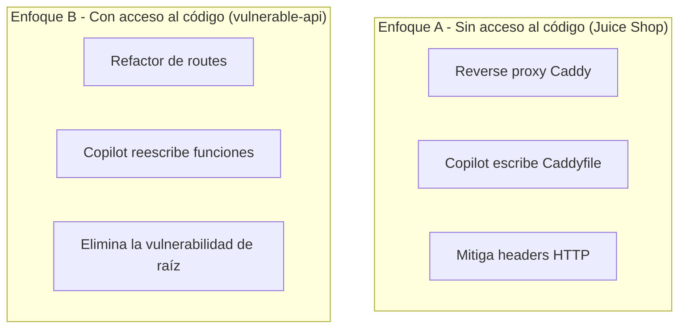

# Remediación en código con GitHub Copilot

> Guion del **módulo 5b** del workshop.
> Este es el **segundo enfoque** de remediación DAST: aplica cuando el código
> vulnerable **sí es tuyo** y puedes arreglar la raíz del problema.
> Complementa el enfoque de reverse proxy documentado en
> [`Remediation.md`](Remediation.md).

---

## Contexto

Con Juice Shop no podíamos tocar el código, así que endurecimos con un
reverse proxy Caddy. Pero en la vida real, la mayoría de las apps que
mantiene tu equipo **sí son tuyas**. Ahí el proxy solo esconde el
problema — la solución correcta es arreglar el código.

Para demostrarlo, el laboratorio incluye una segunda aplicación:
[`app/vulnerable-api/`](../app/vulnerable-api/) — una API Node.js/Express
con **cuatro vulnerabilidades canónicas del OWASP Top 10**, una por
endpoint.

| Endpoint                | Vulnerabilidad     | OWASP Top 10 | Archivo                                                             |
| ----------------------- | ------------------ | ------------ | ------------------------------------------------------------------- |
| `GET /users/search`     | SQL Injection      | A03:2021     | [`src/routes/users.js`](../app/vulnerable-api/src/routes/users.js)  |
| `GET /greet`            | Reflected XSS      | A03:2021     | [`src/routes/greet.js`](../app/vulnerable-api/src/routes/greet.js)  |
| `GET /ping`             | Command Injection  | A03:2021     | [`src/routes/ping.js`](../app/vulnerable-api/src/routes/ping.js)    |
| `GET /files`            | Path Traversal     | A01:2021     | [`src/routes/files.js`](../app/vulnerable-api/src/routes/files.js)  |

---

## Comparación de enfoques



**Mensaje del workshop:** Copilot es útil en los dos escenarios, pero los
prompts y el tipo de output cambian totalmente.

---

## Flujo por vulnerabilidad

Para cada endpoint el ciclo es:

1. **Explotar** la vulnerabilidad con `curl` para probar que existe.
2. **Pedirle a Copilot** el fix con un prompt concreto.
3. **Re-explotar** con el mismo `curl` para comprobar que el fix funciona.

Levantar el laboratorio:

```bash
docker compose up -d
# vulnerable-api queda accesible en http://localhost:4000
```

---

## 1. SQL Injection — `GET /users/search`

### Explotación

```bash
curl -sG "http://localhost:4000/users/search" \
     --data-urlencode "name=' OR '1'='1"
```

Devuelve **todos** los usuarios incluyendo `admin`, ignorando el filtro.

### Código vulnerable

```javascript
const sql = `SELECT id, name, email FROM users WHERE name LIKE '%${name}%'`;
const rows = db.prepare(sql).all();
```

### Prompt para Copilot Chat

> El archivo `app/vulnerable-api/src/routes/users.js` es vulnerable a
> **SQL Injection** porque concatena el parámetro `name` directamente en
> la query. Refactorízalo para usar **prepared statements con parámetros
> ligados** (better-sqlite3 soporta `?`). Mantén la búsqueda por
> substring (`LIKE %...%`). No devuelvas la query cruda en la respuesta.

### Código esperado (después)

```javascript
const stmt = db.prepare(
  'SELECT id, name, email FROM users WHERE name LIKE ?'
);
const rows = stmt.all(`%${name}%`);
res.json({ results: rows });
```

### Verificación

```bash
curl -sG "http://localhost:4000/users/search" --data-urlencode "name=' OR '1'='1"
# → {"results":[]}   (el string se busca literal, sin bypass)
```

---

## 2. Reflected XSS — `GET /greet`

### Explotación

```bash
curl -sG "http://localhost:4000/greet" \
     --data-urlencode "name=<script>alert(1)</script>"
```

El `<script>` se refleja tal cual y se ejecuta en el navegador.

### Código vulnerable

```javascript
const html = `<h1>Hello, ${name}!</h1>`;
res.type('html').send(html);
```

### Prompt para Copilot Chat

> `app/vulnerable-api/src/routes/greet.js` sufre **Reflected XSS**
> porque interpola `name` en HTML sin escapar. Refactorízalo para
> escapar entidades HTML (`<`, `>`, `"`, `'`, `&`). No uses librerías
> externas si podemos evitarlo — implementa una función `escapeHtml`
> pequeña y aplícala al parámetro antes de renderizar.

### Código esperado (después)

```javascript
function escapeHtml(str) {
  return String(str)
    .replace(/&/g, '&amp;')
    .replace(/</g, '&lt;')
    .replace(/>/g, '&gt;')
    .replace(/"/g, '&quot;')
    .replace(/'/g, '&#39;');
}

const html = `<h1>Hello, ${escapeHtml(name)}!</h1>`;
```

### Verificación

```bash
curl -sG "http://localhost:4000/greet" --data-urlencode "name=<script>alert(1)</script>" | grep -c '<script>'
# → 0   (se codifica como &lt;script&gt;)
```

---

## 3. Command Injection — `GET /ping`

### Explotación

```bash
curl -sG "http://localhost:4000/ping" --data-urlencode "host=127.0.0.1;id"
```

Se ejecuta `id` después del ping — se ve `uid=1000(node) gid=1000(node)`.

### Código vulnerable

```javascript
exec(`ping -c 1 -W 1 ${host}`, ..., cb);
```

### Prompt para Copilot Chat

> `app/vulnerable-api/src/routes/ping.js` es vulnerable a **Command
> Injection** porque interpola `host` en un string ejecutado por shell.
> Refactorízalo para:
>
> 1. Usar `child_process.execFile` (sin shell) en lugar de `exec`.
> 2. Validar que `host` cumpla un regex conservador (letras, dígitos,
>    puntos y guiones; máximo 253 caracteres). Rechazar con `400 Bad
>    Request` si no.
> 3. Mantener el timeout de 3 segundos.

### Código esperado (después)

```javascript
const { execFile } = require('child_process');

const HOST_RE = /^[a-zA-Z0-9.\-]{1,253}$/;

router.get('/', (req, res) => {
  const host = req.query.host || '127.0.0.1';
  if (!HOST_RE.test(host)) {
    return res.status(400).type('text/plain').send('invalid host');
  }
  execFile('ping', ['-c', '1', '-W', '1', host], { timeout: 3000 },
    (err, stdout, stderr) => {
      if (err) return res.status(500).type('text/plain').send(stderr);
      res.type('text/plain').send(stdout);
    });
});
```

### Verificación

```bash
curl -sG "http://localhost:4000/ping" --data-urlencode "host=127.0.0.1;id"
# → invalid host   (el regex rechaza el ";")
```

---

## 4. Path Traversal — `GET /files`

### Explotación

```bash
curl -sG "http://localhost:4000/files" \
     --data-urlencode "name=../../../../etc/passwd"
```

Devuelve el contenido de `/etc/passwd` del contenedor.

### Código vulnerable

```javascript
const filePath = path.join(BASE_DIR, name);
fs.readFile(filePath, 'utf-8', ...);
```

`path.join` **normaliza pero no restringe** — permite que `..` suba.

### Prompt para Copilot Chat

> `app/vulnerable-api/src/routes/files.js` es vulnerable a **Path
> Traversal**. Refactorízalo para:
>
> 1. Resolver la ruta final con `path.resolve(BASE_DIR, name)`.
> 2. Verificar que la ruta resuelta empiece con `BASE_DIR + path.sep`.
> 3. Rechazar con `400` si el nombre contiene separadores de ruta o `..`.
> 4. Devolver `404` cuando el archivo no exista, sin filtrar detalles
>    del filesystem.

### Código esperado (después)

```javascript
const path = require('path');
const BASE_DIR = path.resolve(__dirname, '..', '..', 'files');

router.get('/', (req, res) => {
  const name = req.query.name || 'hello.txt';
  if (name.includes('/') || name.includes('\\') || name.includes('..')) {
    return res.status(400).type('text/plain').send('invalid name');
  }
  const filePath = path.resolve(BASE_DIR, name);
  if (!filePath.startsWith(BASE_DIR + path.sep)) {
    return res.status(400).type('text/plain').send('invalid name');
  }
  fs.readFile(filePath, 'utf-8', (err, data) => {
    if (err) return res.status(404).type('text/plain').send('not found');
    res.type('text/plain').send(data);
  });
});
```

### Verificación

```bash
curl -sG "http://localhost:4000/files" --data-urlencode "name=../../../../etc/passwd"
# → invalid name

curl -sG "http://localhost:4000/files" --data-urlencode "name=hello.txt"
# → Hello from vulnerable-api!
```

---

## Verificación integral con OWASP ZAP

Además del check manual con `curl`, se puede correr un **full scan**
(escaneo activo) contra el endpoint. Este scan sí envía payloads reales
y encuentra SQLi, XSS, etc. Contra una app tan pequeña tarda ~2-5 min:

```bash
./scripts/scan.sh full http://vulnerable-api:4000
```

Comparar el reporte antes y después del refactor con Copilot muestra
la reducción concreta de `FAIL-NEW`.

> **Nota:** el `baseline scan` (pasivo) **no** detecta estas
> vulnerabilidades porque no envía payloads; solo verifica lo que
> encuentra al crawlear. Por eso en este módulo usamos `full-scan`.

---

## Puntos didácticos para el instructor

1. **Un prompt = un fix**. Cada vulnerabilidad es autocontenida en un
   archivo pequeño. Perfecto para demostrar Copilot Chat sin que la
   audiencia se pierda en el contexto.
2. **El fix rara vez es solo un `replace`**: para command injection y
   path traversal Copilot añade validación de entrada, cambia la API
   nativa (`execFile` en vez de `exec`, `path.resolve` en vez de
   `path.join`), y mejora los códigos de respuesta.
3. **Verificar siempre con el mismo `curl` de la explotación**. Es el
   feedback loop más rápido y visual del workshop.
4. **La regla general**: cuando tenés el código, arreglá la raíz. El
   reverse proxy es plan B para lo que no controlas.
